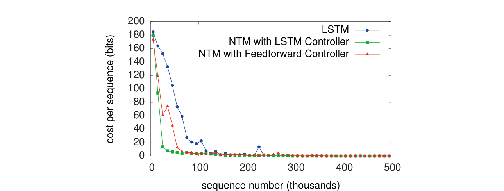

# Page 13 of 26 - Neural Turing Machines

> Page 13 of the source PDF, verbatim as extracted. Canonical document: [16 - Neural Turing Machines](../../papers/16-neural-turing-machines.md)

0 20 40 60 80 100 120 140 160 180 200

LSTM NTM with LSTM Controller NTM with Feedforward Controller

cost per sequence (bits)

0 100 200 300 400 500

sequence number (thousands)

Figure 7: Repeat Copy Learning Curves.

Figure 7 shows that NTM learns the task much faster than LSTM, but both were able to solve it perfectly.3 The difference between the two architectures only becomes clear when they are asked to generalise beyond the training data. In this case we were interested in generalisation along two dimensions: sequence length and number of repetitions. Figure 8 illustrates the effect of doubling first one, then the other, for both LSTM and NTM. Whereas LSTM fails both tests, NTM succeeds with longer sequences and is able to perform more than ten repetitions; however it is unable to keep count of of how many repeats it has completed, and does not predict the end marker correctly. This is probably a consequence of representing the number of repetitions numerically, which does not easily generalise beyond a fixed range.

Figure 9 suggests that NTM learns a simple extension of the copy algorithm in the previous section, where the sequential read is repeated as many times as necessary.

## 4.3 Associative Recall

The previous tasks show that the NTM can apply algorithms to relatively simple, linear data structures. The next order of complexity in organising data arises from “indirection”—that is, when one data item points to another. We test the NTM’s capability for learning an instance of this more interesting class by constructing a list of items so that querying with one of the items demands that the network return the subsequent item. More specifically, we define an item as a sequence of binary vectors that is bounded on the left and right by delimiter symbols. After several items have been propagated to the network, we query by showing a random item, and we ask the network to produce the next item. In our experiments, each item consisted of three six-bit binary vectors (giving a total of 18 bits

3It surprised us that LSTM performed better here than on the copy problem. The likely reasons are that the sequences were shorter (up to length 10 instead of up to 20), and the LSTM network was larger and therefore had more memory capacity.

14

---

[previous page](page-012.md) · [next page](page-014.md) · [all pages](index.md)
