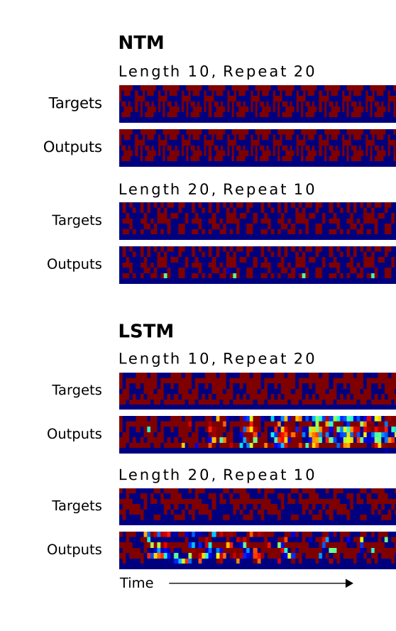

# Page 14 of 26 - Neural Turing Machines

> Page 14 of the source PDF, verbatim as extracted. Canonical document: [16 - Neural Turing Machines](../../papers/16-neural-turing-machines.md)

Figure 8: NTM and LSTM Generalisation for the Repeat Copy Task. NTM generalises almost perfectly to longer sequences than seen during training. When the number of repeats is increased it is able to continue duplicating the input sequence fairly accurately; but it is unable to predict when the sequence will end, emitting the end marker after the end of every repetition beyond the eleventh. LSTM struggles with both increased length and number, rapidly diverging from the input sequence in both cases.

per item). During training, we used a minimum of 2 items and a maximum of 6 items in a single episode.

Figure 10 shows that NTM learns this task significantly faster than LSTM, terminating at near zero cost within approximately 30, 000 episodes, whereas LSTM does not reach zero cost after a million episodes. Additionally, NTM with a feedforward controller learns faster than NTM with an LSTM controller. These two results suggest that NTM’s external memory is a more effective way of maintaining the data structure than LSTM’s internal state. NTM also generalises much better to longer sequences than LSTM, as can be seen in Figure 11. NTM with a feedforward controller is nearly perfect for sequences of up to 12 items (twice the maximum length used in training), and still has an average cost below 1 bit per sequence for sequences of 15 items. In Figure 12, we show the operation of the NTM memory, controlled by an LSTM with one head, on a single test episode. In “Inputs,” we see that the input denotes item delimiters as single bits in row 7. After the sequence of items has been propagated, a

15

---

[previous page](page-013.md) · [next page](page-015.md) · [all pages](index.md)
