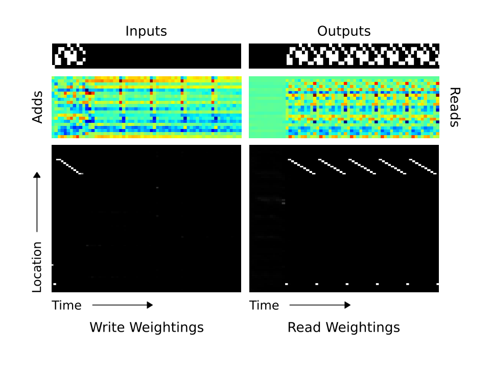
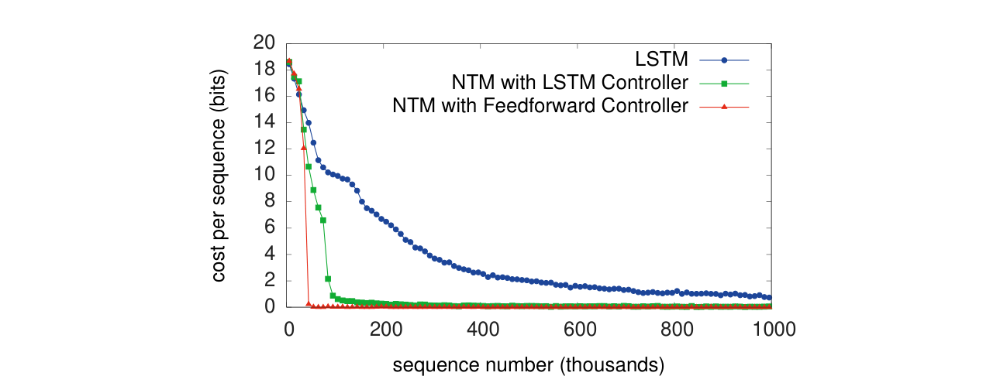

# Page 15 of 26 - Neural Turing Machines

> Page 15 of the source PDF, verbatim as extracted. Canonical document: [16 - Neural Turing Machines](../../papers/16-neural-turing-machines.md)

Figure 9: NTM Memory Use During the Repeat Copy Task. As with the copy task the network first writes the input vectors to memory using iterative shifts. It then reads through the sequence to replicate the input as many times as necessary (six in this case). The white dot at the bottom of the read weightings seems to correspond to an intermediate location used to redirect the head to the start of the sequence (The NTM equivalent of a goto statement).

0 2 4 6 8 10 12 14 16 18 20

LSTM NTM with LSTM Controller NTM with Feedforward Controller

cost per sequence (bits)

0 200 400 600 800 1000

sequence number (thousands)

Figure 10: Associative Recall Learning Curves for NTM and LSTM.

16

---

[previous page](page-014.md) · [next page](page-016.md) · [all pages](index.md)
