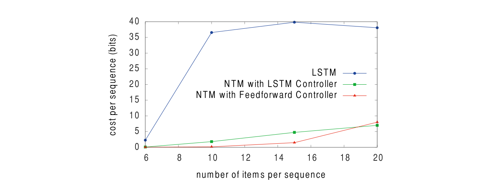

# Page 16 of 26 - Neural Turing Machines

> Page 16 of the source PDF, verbatim as extracted. Canonical document: [16 - Neural Turing Machines](../../papers/16-neural-turing-machines.md)

40

35

cost per sequence (bits)

30

25

LSTM NTM with LSTM Controller NTM with Feedforward Controller

20

15

10

5

0

6 8 10 12 14 16 18 20

num ber of items per sequence

Figure 11: Generalisation Performance on Associative Recall for Longer Item Sequences. The NTM with either a feedforward or LSTM controller generalises to much longer sequences of items than the LSTM alone. In particular, the NTM with a feedforward controller is nearly perfect for item sequences of twice the length of sequences in its training set.

delimiter in row 8 prepares the network to receive a query item. In this case, the query item corresponds to the second item in the sequence (contained in the green box). In “Outputs,” we see that the network crisply outputs item 3 in the sequence (from the red box). In “Read Weightings,” on the last three time steps, we see that the controller reads from contiguous locations that each store the time slices of item 3. This is curious because it appears that the network has jumped directly to the correct location storing item 3. However we can explain this behaviour by looking at “Write Weightings.” Here we see that the memory is written to even when the input presents a delimiter symbol between items. One can confirm in “Adds” that data are indeed written to memory when the delimiters are presented (e.g., the data within the black box); furthermore, each time a delimiter is presented, the vector added to memory is different. Further analysis of the memory reveals that the network accesses the location it reads after the query by using a content-based lookup that produces a weighting that is shifted by one. Additionally, the key used for content-lookup corresponds to the vector that was added in the black box. This implies the following memory-access algorithm: when each item delimiter is presented, the controller writes a compressed representation of the previous three time slices of the item. After the query arrives, the controller recomputes the same compressed representation of the query item, uses a content-based lookup to find the location where it wrote the first representation, and then shifts by one to produce the subsequent item in the sequence (thereby combining content-based lookup with location-based offsetting).

## 4.4 Dynamic N-Grams

The goal of the dynamic N-Grams task was to test whether NTM could rapidly adapt to new predictive distributions. In particular we were interested to see if it were able to use its

17

---

[previous page](page-015.md) · [next page](page-017.md) · [all pages](index.md)
