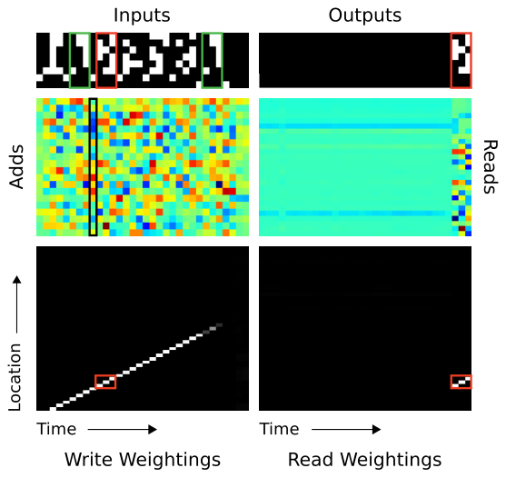
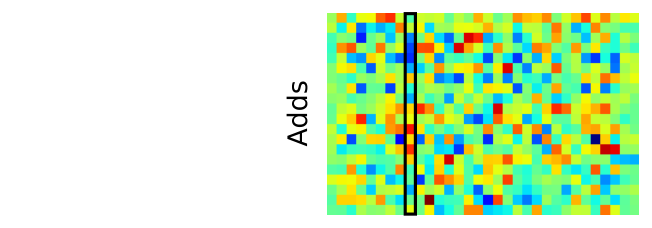

# Page 17 of 26 - Neural Turing Machines

> Page 17 of the source PDF, verbatim as extracted. Canonical document: [16 - Neural Turing Machines](../../papers/16-neural-turing-machines.md)

Figure 12: NTM Memory Use During the Associative Recall Task. In “Inputs,” a sequence of items, each composed of three consecutive binary random vectors is propagated to the controller. The distinction between items is designated by delimiter symbols (row 7 in “Inputs”). After several items have been presented, a delimiter that designates a query is presented (row 8 in “Inputs”). A single query item is presented (green box), and the network target corresponds to the subsequent item in the sequence (red box). In “Outputs,” we see that the network correctly produces the target item. The red boxes in the read and write weightings highlight the three locations where the target item was written and then read. The solution the network finds is to form a compressed representation (black box in “Adds”) of each item that it can store in a single location. For further analysis, see the main text.

memory as a re-writable table that it could use to keep count of transition statistics, thereby emulating a conventional N-Gram model.

We considered the set of all possible 6-Gram distributions over binary sequences. Each 6-Gram distribution can be expressed as a table of 25 = 32 numbers, specifying the probability that the next bit will be one, given all possible length five binary histories. For each training example, we first generated random 6-Gram probabilities by independently drawing all 32 probabilities from the Beta(1

2, 1 2) distribution. We then generated a particular training sequence by drawing 200 successive bits using the current lookup table.4 The network observes the sequence one bit at a time and is then asked to predict the next bit. The optimal estimator for the problem can be determined by

4The first 5 bits, for which insufficient context exists to sample from the table, are drawn i.i.d. from a Bernoulli distribution with p = 0.5.

18

---

[previous page](page-016.md) · [next page](page-018.md) · [all pages](index.md)
