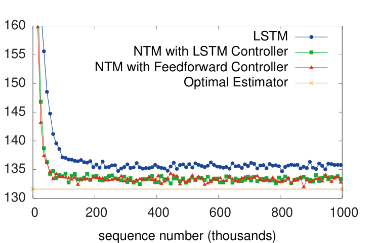

# Page 18 of 26 - Neural Turing Machines

> Page 18 of the source PDF, verbatim as extracted. Canonical document: [16 - Neural Turing Machines](../../papers/16-neural-turing-machines.md)

160

LSTM NTM with LSTM Controller NTM with Feedforward Controller

cost per sequence (bits)

155

Optimal Estimator

150

145

140

135

130

0 200 400 600 800 1000

sequence number (thousands)

Figure 13: Dynamic N-Gram Learning Curves.

Bayesian analysis (Murphy, 2012):

P(B = 1|N1, N0, c) = N1 + 1

2 N1 + N0 + 1 (10)

where c is the five bit previous context, B is the value of the next bit and N0 and N1 are respectively the number of zeros and ones observed after c so far in the sequence. We can therefore compare NTM to the optimal predictor as well as LSTM. To assess performance we used a validation set of 1000 length 200 sequences sampled from the same distribution as the training data. As shown in Figure 13, NTM achieves a small, but significant performance advantage over LSTM, but never quite reaches the optimum cost.

The evolution of the two architecture’s predictions as they observe new inputs is shown in Figure 14, along with the optimal predictions. Close analysis of NTM’s memory usage (Figure 15) suggests that the controller uses the memory to count how many ones and zeros it has observed in different contexts, allowing it to implement an algorithm similar to the optimal estimator.

## 4.5 Priority Sort

This task tests whether the NTM can sort data—an important elementary algorithm. A sequence of random binary vectors is input to the network along with a scalar priority rating for each vector. The priority is drawn uniformly from the range \[-1, 1\]. The target sequence contains the binary vectors sorted according to their priorities, as depicted in Figure 16.

Each input sequence contained 20 binary vectors with corresponding priorities, and each target sequence was the 16 highest-priority vectors in the input.5 Inspection of NTM’s

5We limited the sort to size 16 because we were interested to see if NTM would solve the task using a binary heap sort of depth 4.

19

---

[previous page](page-017.md) · [next page](page-019.md) · [all pages](index.md)
