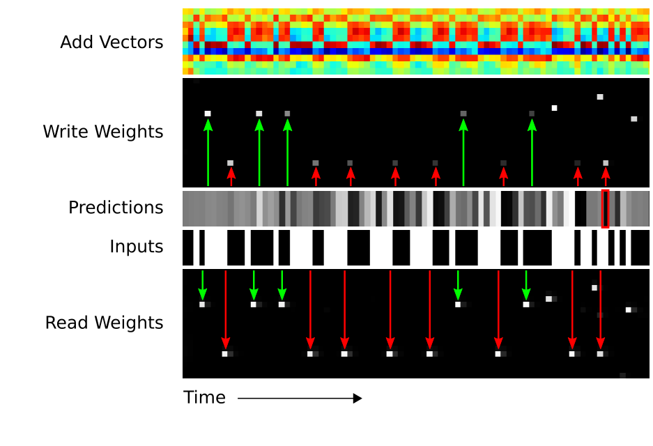

# Page 19 of 26 - Neural Turing Machines

> Page 19 of the source PDF, verbatim as extracted. Canonical document: [16 - Neural Turing Machines](../../papers/16-neural-turing-machines.md)

Figure 14: Dynamic N-Gram Inference. The top row shows a test sequence from the N-Gram task, and the rows below show the corresponding predictive distributions emitted by the optimal estimator, NTM, and LSTM. In most places the NTM predictions are almost indistinguishable from the optimal ones. However at the points indicated by the two arrows it makes clear mistakes, one of which is explained in Figure 15. LSTM follows the optimal predictions closely in some places but appears to diverge further as the sequence progresses; we speculate that this is due to LSTM “forgetting” the observations at the start of the sequence.

Figure 15: NTM Memory Use During the Dynamic N-Gram Task. The red and green arrows indicate point where the same context is repeatedly observed during the test sequence (“00010” for the green arrows, “01111” for the red arrows). At each such point the same location is accessed by the read head, and then, on the next time-step, accessed by the write head. We postulate that the network uses the writes to keep count of the fraction of ones and zeros following each context in the sequence so far. This is supported by the add vectors, which are clearly anti-correlated at places where the input is one or zero, suggesting a distributed “counter.” Note that the write weightings grow fainter as the same context is repeatedly seen; this may be because the memory records a ratio of ones to zeros, rather than absolute counts. The red box in the prediction sequence corresponds to the mistake at the first red arrow in Figure 14; the controller appears to have accessed the wrong memory location, as the previous context was “01101” and not “01111.”

20

---

[previous page](page-018.md) · [next page](page-020.md) · [all pages](index.md)
