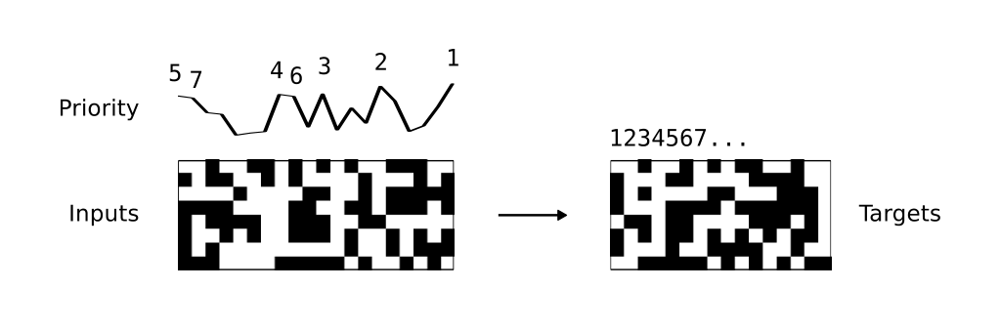
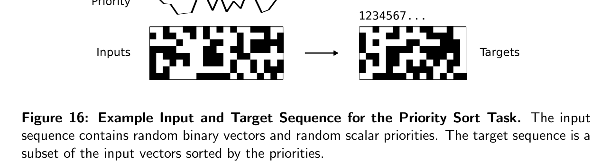
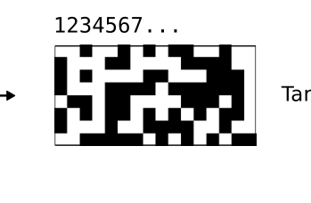
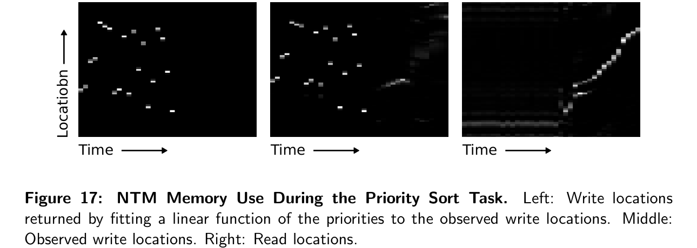

# Page 20 of 26 - Neural Turing Machines

> Page 20 of the source PDF, verbatim as extracted. Canonical document: [16 - Neural Turing Machines](../../papers/16-neural-turing-machines.md)

Figure 16: Example Input and Target Sequence for the Priority Sort Task. The input sequence contains random binary vectors and random scalar priorities. The target sequence is a subset of the input vectors sorted by the priorities.

Hypothesised Locations

Write Weightings

Read Weightings

Locatiobn

Time Time Time

Figure 17: NTM Memory Use During the Priority Sort Task. Left: Write locations returned by fitting a linear function of the priorities to the observed write locations. Middle: Observed write locations. Right: Read locations.

memory use led us to hypothesise that it uses the priorities to determine the relative location of each write. To test this hypothesis we fitted a linear function of the priority to the observed write locations. Figure 17 shows that the locations returned by the linear function closely match the observed write locations. It also shows that the network reads from the memory locations in increasing order, thereby traversing the sorted sequence.

The learning curves in Figure 18 demonstrate that NTM with both feedforward and LSTM controllers substantially outperform LSTM on this task. Note that eight parallel read and write heads were needed for best performance with a feedforward controller on this task; this may reflect the difficulty of sorting vectors using only unary vector operations (see Section 3.4).

## 4.6 Experimental Details

For all experiments, the RMSProp algorithm was used for training in the form described in (Graves, 2013) with momentum of 0.9. Tables 1 to 3 give details about the network configurations and learning rates used in the experiments. All LSTM networks had three stacked hidden layers. Note that the number of LSTM parameters grows quadratically with

21

---

[previous page](page-019.md) · [next page](page-021.md) · [all pages](index.md)
