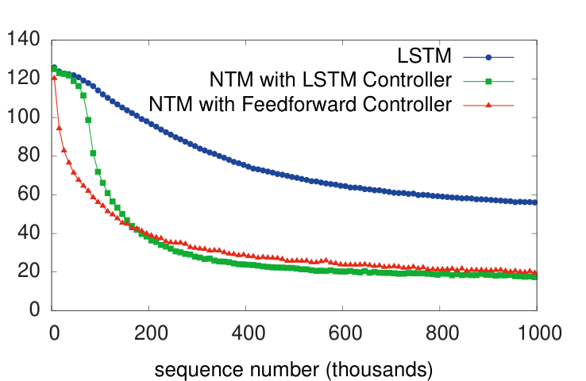

# Page 21 of 26 - Neural Turing Machines

> Page 21 of the source PDF, verbatim as extracted. Canonical document: [16 - Neural Turing Machines](../../papers/16-neural-turing-machines.md)

140

LSTM NTM with LSTM Controller NTM with Feedforward Controller

cost per sequence (bits)

120

100

80

60

40

20

0

0 200 400 600 800 1000

sequence number (thousands)

Figure 18: Priority Sort Learning Curves.

Task #Heads Controller Size Memory Size Learning Rate #Parameters

Copy 1 100 128 × 20 10−4 17, 162 Repeat Copy 1 100 128 × 20 10−4 16, 712 Associative 4 256 128 × 20 10−4 146, 845 N-Grams 1 100 128 × 20 3 × 10−5 14, 656 Priority Sort 8 512 128 × 20 3 × 10−5 508, 305

## Table 1: NTM with Feedforward Controller Experimental Settings

the number of hidden units (due to the recurrent connections in the hidden layers). This contrasts with NTM, where the number of parameters does not increase with the number of memory locations. During the training backward pass, all gradient components are clipped elementwise to the range (-10, 10).

## 5 Conclusion

We have introduced the Neural Turing Machine, a neural network architecture that takes inspiration from both models of biological working memory and the design of digital computers. Like conventional neural networks, the architecture is differentiable end-to-end and can be trained with gradient descent. Our experiments demonstrate that it is capable of learning simple algorithms from example data and of using these algorithms to generalise well outside its training regime.

22

---

[previous page](page-020.md) · [next page](page-022.md) · [all pages](index.md)
