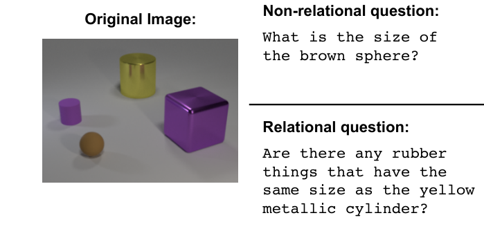

# Page 1 of 16 - A Simple Neural Network Module for Relational Reasoning

> Page 1 of the source PDF, verbatim as extracted. Canonical document: [17 - A Simple Neural Network Module for Relational Reasoning](../../papers/17-simple-neural-network-module-for-relational-reasoning.md)

## Non-relational question:

## Original Image:

What is the size of the brown sphere?

## Relational question:

Are there any rubber things that have the same size as the yellow metallic cylinder?

Figure 1: An illustrative example from the CLEVR dataset of relational reasoning. An image containing four objects is shown alongside non-relational and relational questions. The relational question requires explicit reasoning about the relations between the four objects in the image, whereas the non-relational question requires reasoning about the attributes of a particular object.

difficult for powerful neural network architectures such as convolutional neural networks (CNNs) and multi-layer perceptrons (MLPs).

Here, we explore “Relation Networks” (RN) as a general solution to relational reasoning in neural networks. RNs are architectures whose computations focus explicitly on relational reasoning \[35\]. Although several other models supporting relation-centric computation have been proposed, such as Graph Neural Networks, Gated Graph Sequence Neural Networks, and Interaction Networks, \[37, 26, 2\], RNs are simple, plug-and-play, and are exclusively focused on flexible relational reasoning. Moreover, through joint training RNs can influence and shape upstream representations in CNNs and LSTMs to produce implicit object-like representations that it can exploit for relational reasoning. We applied an RN-augmented architecture to CLEVR \[15\], a recent visual question answering (QA) dataset on which state-of-the-art approaches have struggled due to the demand for rich

relational reasoning. Our networks vastly outperformed the best generally-applicable visual QA architectures, and achieve state-of-the-art, super-human performance. RNs also solve CLEVR from state descriptions, highlighting their versatility in regards to the form of their input. We also applied an RN-based architecture to the bAbI text-based QA suite \[41\] and solved 18/20 of the subtasks. Finally, we trained an RN to make challenging relational inferences about complex physical systems and motion capture data. The success of RNs across this set of substantially dissimilar task domains is testament to the general utility of RNs for solving problems that require relation reasoning.

## 2 Relation Networks

An RN is a neural network module with a structure primed for relational reasoning. The design philosophy behind RNs is to constrain the functional form of a neural network so that it captures the core common properties of relational reasoning. In other words, the capacity to compute relations is baked into the RN architecture without needing to be learned, just as the capacity to reason about spatial, translation invariant properties is built-in to CNNs, and the capacity to reason about sequential dependencies is built into recurrent neural networks.

In its simplest form the RN is a composite function:





X

RN(O) = fφ

gθ(oi, oj)

, (1)

i,j

where the input is a set of “objects” O = {o1, o2, ..., on}, oi ∈Rm is the ith object, and fφ and gθ are functions with parameters φ and θ, respectively. For our purposes, fφ and gθ are MLPs, and the

2

---

first page · [next page](page-002.md) · [all pages](index.md)
