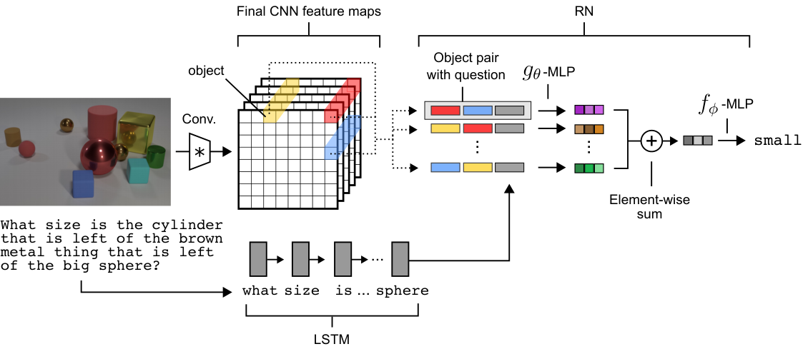

# Page 5 of 16 - A Simple Neural Network Module for Relational Reasoning

> Page 5 of the source PDF, verbatim as extracted. Canonical document: [17 - A Simple Neural Network Module for Relational Reasoning](../../papers/17-simple-neural-network-module-for-relational-reasoning.md)

Final CNN feature maps RN

Object pair with question

object

-MLP

-MLP

Conv.

small +

...

...

\*

Element-wise

sum

What size is the cylinder that is left of the brown metal thing that is left of the big sphere?

...

...

is sphere what size

LSTM

Figure 2: Visual QA architecture. Questions are processed with an LSTM to produce a question embedding, and images are processed with a CNN to produce a set of objects for the RN. Objects (three examples illustrated here in yellow, red, and blue) are constructed using feature-map vectors

from the convolved image. The RN considers relations across all pairs of objects, conditioned on the question embedding, and integrates all these relations to answer the question.

Dealing with state descriptions We can provide state descriptions directly into the RN, since state descriptions are pre-factored object representations. Question processing can proceed as before: questions pass through an LSTM using a learnable lookup embedding for individual words, and the final state of the LSTM is concatenated to each object-pair.

Dealing with natural language For the bAbI suite of tasks the natural language inputs must be transformed into a set of objects. This is a distinctly different requirement from visual QA, where objects were defined as spatially distinct regions in convolved feature maps. So, we first identified up to 20 sentences in the support set that were immediately prior to the probe question. Then, we tagged these sentences with labels indicating their relative position in the support set, and processed each sentence word-by-word with an LSTM (with the same LSTM acting on each sentence independently). We note that this setup invokes minimal prior knowledge, in that we delineate objects as sentences, whereas previous bAbI models processed all word tokens from all support sentences sequentially. It’s unclear how much of an advantage this prior knowledge provides, since period punctuation also unambiguously delineates sentences for the token-by-token processing models. The final state of the sentence-processing-LSTM is considered to be an object. Similar to visual QA, a separate LSTM produced a question embedding, which was appened to each object pair as input to the RN. Our model was trained on the joint version of bAbI (all 20 tasks simultaneously), using the full dataset of 10K examples per task.

Model configuration details For the CLEVR-from-pixels task we used: 4 convolutional layers each with 24 kernels, ReLU non-linearities, and batch normalization; 128 unit LSTM for question processing; 32 unit word-lookup embeddings; four-layer MLP consisting of 256 units per layer with ReLU non-linearities for gθ; and a three-layer MLP consisting of 256, 256 (with 50% dropout), and 29 units with ReLU non-linearities for fφ. The final layer was a linear layer that produced logits for a softmax over the answer vocabulary. The softmax output was optimized with a cross-entropy loss function using the Adam optimizer with a learning rate of 2.5e−4. We used size 64 mini-batches and distributed training with 10 workers synchronously updating a central parameter server. The configurations for the other tasks are similar, and can be found in the supplementary information.

We’d like to emphasize the simplicity of our overall model architecture compared to the visual QA architectures used on CLEVR thus far, which use ResNet or VGG embeddings, sometimes with

6

---

[previous page](page-004.md) · [next page](page-006.md) · [all pages](index.md)
