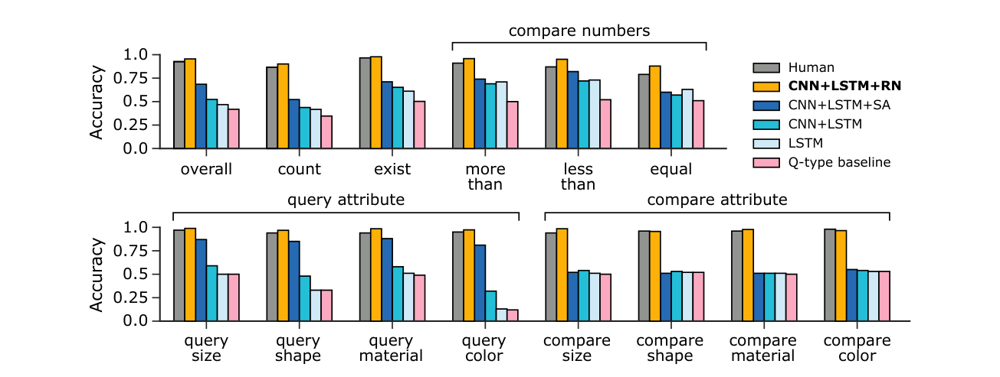

# Page 7 of 16 - A Simple Neural Network Module for Relational Reasoning

> Page 7 of the source PDF, verbatim as extracted. Canonical document: [17 - A Simple Neural Network Module for Relational Reasoning](../../papers/17-simple-neural-network-module-for-relational-reasoning.md)

compare numbers

1.0

Human

Accuracy Accuracy

0.75

LSTM CNN+LSTM CNN+LSTM+SA CNN+LSTM+RN

0.5

0.25

0.0

Q-type baseline

than exist count overall

equal less than more

compare attribute query attribute

1.0

0.75

0.5

0.25

0.0

query

query shape

query material

query

compare

compare

compare

compare

size

color

size

shape

material

color

Figure 3: Results on CLEVR from pixels. The RN augmented model outperformed all other models and exhibited super-human performance overall. In particular, it solved “compare attribute” questions, which trouble all other models because they heavily depend on relational reasoning.

## 5.3 Sort-of-CLEVR from pixels

The results so far led us to hypothesize that the difficulty in solving CLEVR lies in its heavy emphasis on relational reasoning, contrary to previous claims that the difficulty lies in question parsing \[17\]. However, the questions in the CLEVR dataset are not categorized based on the degree to which they may be relational, making it hard to assess our hypothesis. Therefore, we use the Sort-of-CLEVR dataset which we explicitly designed to seperate out relational and non-relational questions (see Section 3.2).

We find that a CNN augmented with an RN achieves an accuracy above 94% for both relational and non-relational questions. However, a CNN augmented with an MLP only reached this performance on the non-relational questions, plateauing at 63% on the relational questions. This strongly indicates that models lacking a dedicated relational reasoning component struggle, or may even be completely incapable of solving tasks that require very simple relational reasoning. Augmenting these models with a relational module, like the RN, is sufficient to overcome this hurdle.

A simple “closest-to” or “furthest-from” relation is particularly revealing of a CNN+MLP’s lack of general reasoning capabilities (52.3% success). For these relations a model must gauge the distances between each object, and then compare each of these distances. Moreover, depending on the images, the relevant distance could be quite small in magnitude, or quite large, further increasing the combinatoric difficulty of this task.

## 5.4 bAbI

Our model succeeded on 18/20 tasks. Notably, it succeeded on the basic induction task (2.1% total error), which proved difficult for the Sparse DNC (54%), DNC (55.1%), and EntNet (52.1%). Also, our model did not catastrophically fail in any of the tasks: for the 2 tasks that it failed (the “two supporting facts”, and “three supporting facts” tasks), it missed the 95% threshold by 3.1%

and 11.5%, respectively. We also note that the model we evaluated was chosen based on overall performance on a withheld validation set, using a single seed. That is, we did not run multiple replicas with the best hyperparameter settings (as was done in other models, such as the Sparse DNC, which demonstrated performance fluctuations with a standard deviation of more than ±3 tasks passed for the best choice of hyperparameters).

## 5.5 Dynamic physical systems

Finally, we trained our model on two tasks requiring reasoning about the dynamics of balls moving along a surface. In the connection inference task, our model correctly classified all the connections in

8

---

[previous page](page-006.md) · [next page](page-008.md) · [all pages](index.md)
