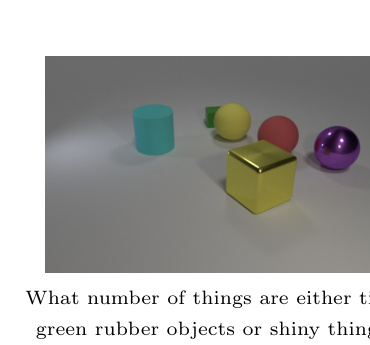
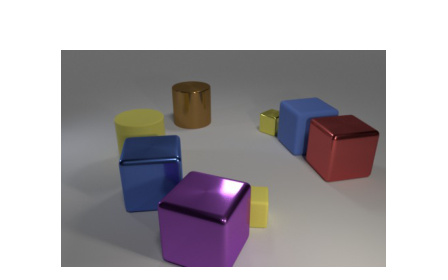
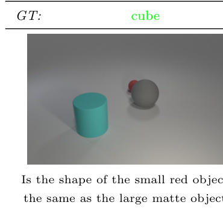
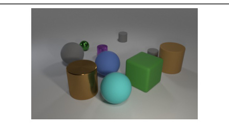
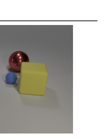
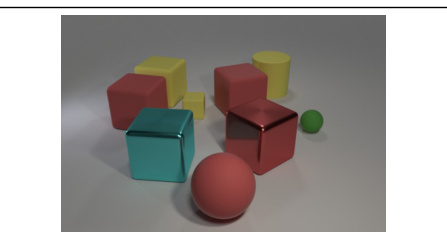
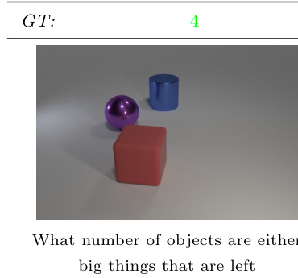
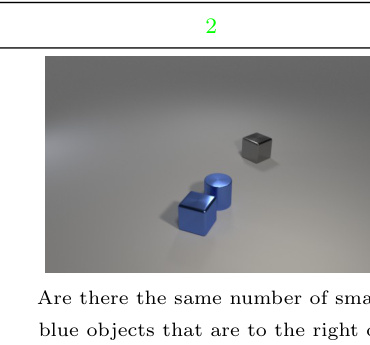

# Page 13 of 16 - A Simple Neural Network Module for Relational Reasoning

> Page 13 of the source PDF, verbatim as extracted. Canonical document: [17 - A Simple Neural Network Module for Relational Reasoning](../../papers/17-simple-neural-network-module-for-relational-reasoning.md)

What shape is the small object What number of things are either tiny What number of objects are blocks

that is in front of the yellow matte green rubber objects or shiny things that are in front of the large

thing and behind the gray sphere? that are behind the big metal block? red cube or green balls?

RN: cylinder 1 2

GT: cube 2 3

Is the shape of the small red object How many gray objects are in front What number of objects are big

the same as the large matte object of the tiny green shiny ball and right red matte cubes or things on the right

that is right of the small rubber ball? of the big blue matte thing? side of the large red matte block?

RN: no 0 5

GT: yes 1 6

There is a brown ball; How many objects are big purple How many things are rubber

what number of things are left of it? rubber blocks or red blocks in front cylinders in front of the tiny yellow

of the tiny yellow rubber thing? block or blocks that are to the right

of the small brown rubber thing?

RN: 3 3 2

GT: 4 2 3

What number of objects are either Are there the same number of small What number of other things

big things that are left blue objects that are to the right of are there of the same

of the cylinder or cylinders? the blue cube and blue metal cubes? material as the green cube?

RN: 2 no 6

GT: 3 yes 5

Table 2: Failures on CLEVR; RN – predicted answers, GT – ground-truth answer.

14

---

[previous page](page-012.md) · [next page](page-014.md) · [all pages](index.md)
