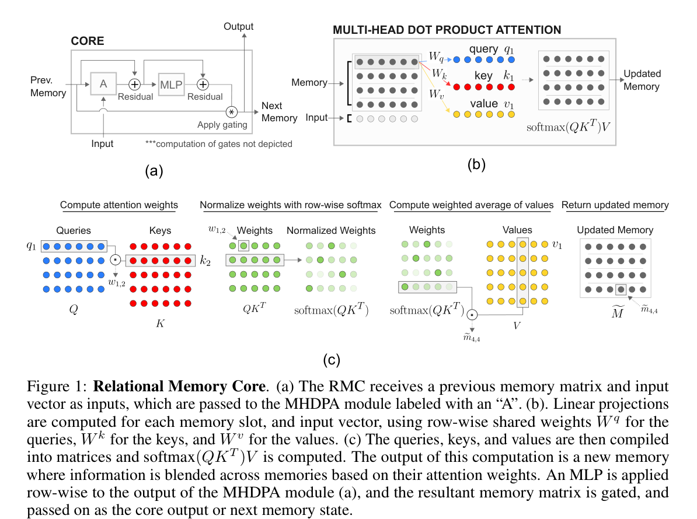

# Page 2 of 18 - Relational Recurrent Neural Networks

> Page 2 of the source PDF, verbatim as extracted. Canonical document: [18 - Relational Recurrent Neural Networks](../../papers/18-relational-recurrent-neural-networks.md)

Output

## MULTI-HEAD DOT PRODUCT ATTENTION

## CORE

query

Updated Memory

key

Prev. Memory

Memory

A

MLP

+

+

Residual

Residual

value

Next Memory

\*

Input

Apply gating

Input

\*\*\*computation of gates not depicted

(b)

(a)

Compute attention weights

Normalize weights with row-wise softmax

Compute weighted average of values Return updated memory

Keys Queries

Weights

Values

Updated Memory

Weights Normalized Weights

## .

## .

(c)

Figure 1: Relational Memory Core. (a) The RMC receives a previous memory matrix and input vector as inputs, which are passed to the MHDPA module labeled with an “A”. (b). Linear projections are computed for each memory slot, and input vector, using row-wise shared weights W q for the queries, W k for the keys, and W v for the values. (c) The queries, keys, and values are then compiled into matrices and softmax(QKT )V is computed. The output of this computation is a new memory where information is blended across memories based on their attention weights. An MLP is applied row-wise to the output of the MHDPA module (a), and the resultant memory matrix is gated, and passed on as the core output or next memory state.

self-attention. Using MHDPA, each memory will attend over all of the other memories, and will update its content based on the attended information.

First, a simple linear projection is used to construct queries (Q = MW q), keys (K = MW k), and values (V = MW v) for each memory (i.e. row mi) in matrix M. Next, we use the queries, Q, to perform a scaled dot-product attention over the keys, K. The returned scalars can be put through a softmax-function to produce a set of weights, which can then be used to return a weighted average of values from V as A(Q, K, V ) = softmax

QKT

V , where dk is the dimensionality of the key vectors used as a scaling factor. Equivalently:

√dk

MW q(MW k)T

MW v, where θ = (W q, W k, W v) (1)

√dk

Aθ(M) = softmax

The output of Aθ(M), which we will denote as f M, is a matrix with the same dimensionality as M. f M can be interpreted as a proposed update to M, with each emi comprising information from memories mj. Thus, in one step of attention each memory is updated with information originating from other memories, and it is up to the model to learn (via parameters W q, W k, and W v) how to shuttle information from memory to memory.

As implied by the name, MHDPA uses multiple heads. We implement this producing h sets of queries, keys, and values, using unique parameters to compute a linear projection from the original memory for each head h. We then independently apply an attention operation for each head. For example, if M is an N × F dimensional matrix and we employ two attention heads, then we compute g M 1 = Aθ(M) and g M 2 = Aφ(M), where g M 1 and g M 2 are N ×F/2 matrices, θ and φ denote unique parameters for the linear projections to produce the queries, keys, and values, and f M = \[g M 1 : g M 2\], where \[:\] denotes column-wise concatenation. Intuitively, heads could be useful for letting a memory share different information, to different targets, using each head.

---

[previous page](page-001.md) · [next page](page-003.md) · [all pages](index.md)
