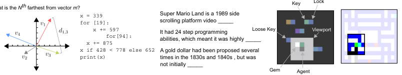
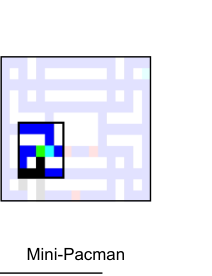

# Page 4 of 18 - Relational Recurrent Neural Networks

> Page 4 of the source PDF, verbatim as extracted. Canonical document: [18 - Relational Recurrent Neural Networks](../../papers/18-relational-recurrent-neural-networks.md)

Lock Key

What is the Nth farthest from vector m?

Super Mario Land is a 1989 side scrolling platform video \_\_\_\_\_

x = 339 for \[19\]: x += 597 for\[94\]: x += 875 x if 428 < 778 else 652 print(x)

Loose Key

Viewport

It had 24 step programming abilities, which meant it was highly \_\_\_\_\_

A gold dollar had been proposed several times in the 1830s and 1840s , but was not initially \_\_\_\_\_

Agent Gem

Program Evaluation Nth farthest Language Modeling

BoxWorld Mini-Pacman

Supervised Learning

Reinforcement Learning

Figure 2: Tasks. We tested the RMC on a suite of supervised and reinforcement learning tasks. Notable are the N th Farthest toy task and language modeling. In the former, the solution requires explicit relational reasoning since the model must sort distance relations between vectors, and not the vectors themselves. The latter tests the model on a large quantity of natural data and allows us to compare performance to well-tuned models.

Thus, we have a number of tune-able parameters: the number of memories, the size of each memory, the number of attention heads, the number of steps of attention, the gating method, and the postattention processor gψ. In the appendix we list the exact configurations for each task.

## 4 Experiments

Here we briefly outline the tasks on which we applied the RMC, and direct the reader to the appendix for full details on each task and details on hyperparameter settings for the model.

## 4.1 Illustrative supervised tasks

N th Farthest The N th Farthest task is designed to stress a capacity for relational reasoning across time. Inputs are a sequence of randomly sampled vectors, and targets are answers to a question of the form: “What is the nth farthest vector (in Euclidean distance) from vector m?”, where the vector values, their IDs, n, and m are randomly sampled per sequence. It is not enough to simply encode and retrieve information as in a copy task. Instead, a model must compute all pairwise distance relations to the reference vector m, which might also lie in memory, or might not have even been provided as input yet. It must then implicitly sort these distances to produce the answer. We emphasize that the model must sort distance relations between vectors, and not the vectors themselves.

Program Evaluation The Learning to Execute (LTE) dataset \[25\] consists of algorithmic snippets from a Turing complete programming language of pseudo-code, and is broken down into three categories: addition, control, and full program. Inputs are a sequence of characters over an alphanumeric vocabulary representing such snippets, and the target is a numeric sequence of characters that is the execution output for the given programmatic input. Given that the snippets involve symbolic manipulation of variables, we felt it could strain a model’s capacity for relational reasoning; since symbolic operators can be interpreted as defining a relation over the operands, successful learning could reflect an understanding of this relation. To also assess model performance on classical sequence tasks we also evaluated on memorization tasks, in which the output is simply a permuted form of the input rather than an evaluation from a set of operational instructions. See the appendix for further experimental details.

## 4.2 Reinforcement learning

Mini Pacman with viewport We follow the formulation of Mini Pacman from \[26\]. Briefly, the agent navigates a maze to collect food while being chased by ghosts. However, we implement this task with a viewport: a 5 × 5 window surrounding the agent that comprises the perceptual input. The task is therefore partially observable, since the agent must navigate the space and take in information through this viewport. Thus, the agent must predict the dynamics of the ghosts in memory, and plan its navigation accordingly, also based on remembered information about which food has already been

---

[previous page](page-003.md) · [next page](page-005.md) · [all pages](index.md)
