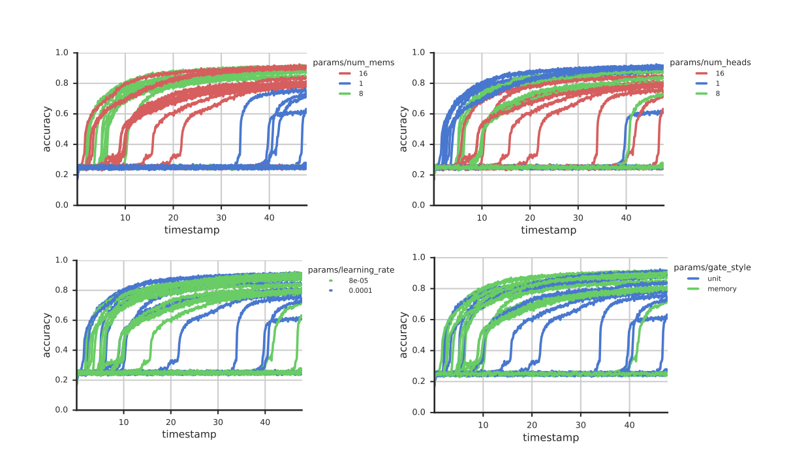
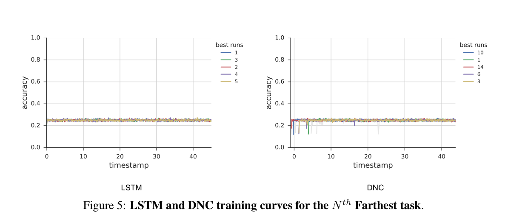

# Page 13 of 18 - Relational Recurrent Neural Networks

> Page 13 of the source PDF, verbatim as extracted. Canonical document: [18 - Relational Recurrent Neural Networks](../../papers/18-relational-recurrent-neural-networks.md)

Figure 4: N th Farthest hyperparameter analysis. Timestamp refers to hours of training. There is a clear effect with the number of memories, with 8 or 16 memories being better than 1. Interestingly, when the model had 1 memory we observed an effect with the number of heads, with more heads (8 or 16) being better than one, possibly indicating that the RMC can learn to compartmentalise and relate information across heads in addition to across memories.

LSTM DNC

Figure 5: LSTM and DNC training curves for the N th Farthest task.

the dependency on the ground truth altogether when training the decoder \[39\] and using a non-auto-regressive regime where model predictions only were used during training. It turned out that this approach tended to yield the strongest results.

Following are the encoder/decoder configurations for a collection of memory models that performed best over all tasks. With the RMC we swept over two and four memories, and two and four attention heads, a total memory size of 1024 and 2048 (divided across memories), a single pass of self attention per step and scalar memory gating. For the baselines, the LSTM is a two layer model and we swept over models with 1024 and 2048 units per layer, skip connections and layer-wise outputs concatenated on the final layer. The DNC used a memory size of 80, word size 64, four read heads and one write head, a 2-layer controller sweeping over 128, 256 and 512 latent units per layer, larger settings than this tended to hurt performance. Also for the DNC, an LSTM controller is used for Program Evaluation problems, and feed-forward controller for memorization. Finally, the EntNet was compared with a total memory size of either 1024 or 2048 with 2, 4, 6, or 8 memory cells where total memory size is divided among memories and the states of the cells are summed to produce an output. All results reported are from the strongest performing hyper-parameter setting for the given model.

---

[previous page](page-012.md) · [next page](page-014.md) · [all pages](index.md)
