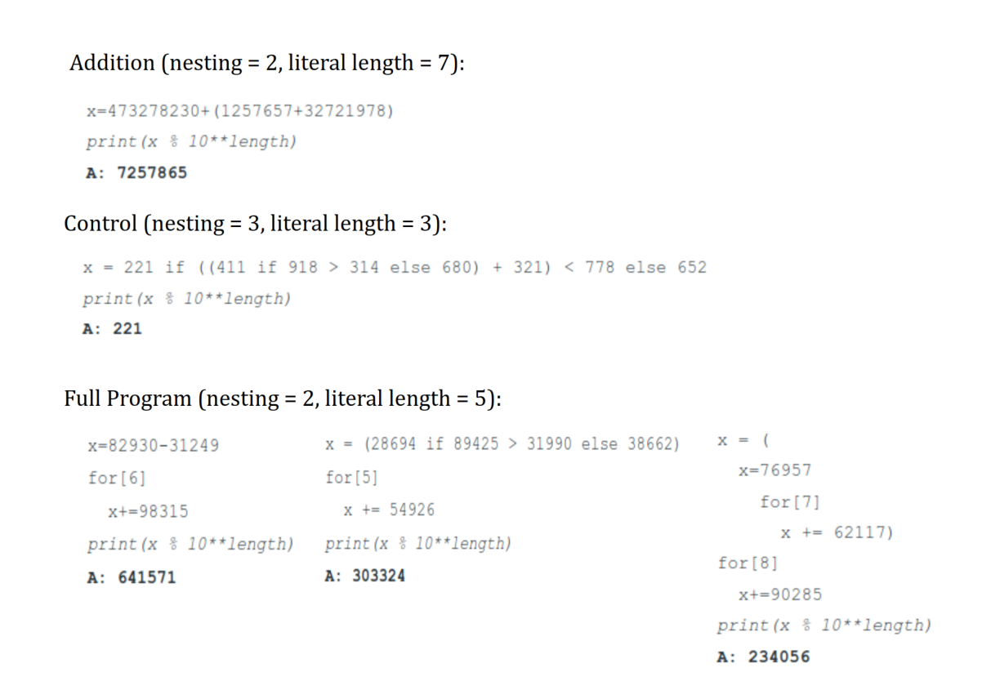
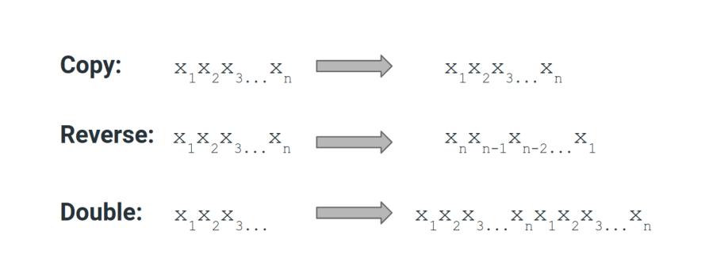

# Page 14 of 18 - Relational Recurrent Neural Networks

> Page 14 of the source PDF, verbatim as extracted. Canonical document: [18 - Relational Recurrent Neural Networks](../../papers/18-relational-recurrent-neural-networks.md)

Figure 6: Samples of programmatic tasks. Note that training samples will sample literal length up to including the maximum length.

Figure 7: Memorization tasks. Each sub-task takes the form of a list permutation.

As seen in figure 8 the RMC tends to quickly achieve high performance relative to the baselines, this demonstrates good data efficiency for these tasks especially when compared to the LSTM. From the same figure and table 1 (the results in the table depict converged accuracy scores for nesting 2 and literal length 5) it is also clear that the RMC scores well among the full set of program evaluation tasks where the DNC faltered on the control task and the EntNet on copy and double tasks. It should finally be noted that due to the RMC model size scaling with respect to total memory size over number of memories and consequently the top performing LSTM models contained many more parameters than the top performing RMC models.

## A.3 Viewport BoxWorld

We study a variant of BoxWorld, which is a pixel-based, highly combinatorial reinforcement learning environment that demands relational reasoning-based planning, initially developed in \[46\]. It consists of a grid of 14 × 14 pixels: grey pixels denote the background, lone colored pixels are keys that can be picked up, and duples of colored pixels are locks and keys, where the right pixel of the duple denotes the color of the lock (and hence the color of the key that is needed to open the lock), and the left pixel denotes the color of the key that would be obtained should the agent open the lock. The agent is denoted by a dark grey pixel, and has four actions: up, down, left, right. To make this task demand relational reasoning in a memory space, the agent only has perceptual access to a 5 × 5 RGB window, or viewport, appended with an extra frame denoting the color of the

---

[previous page](page-013.md) · [next page](page-015.md) · [all pages](index.md)
