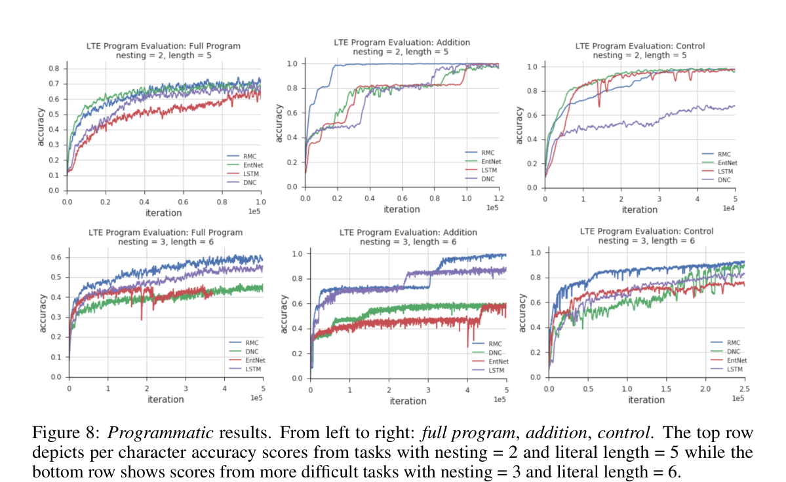
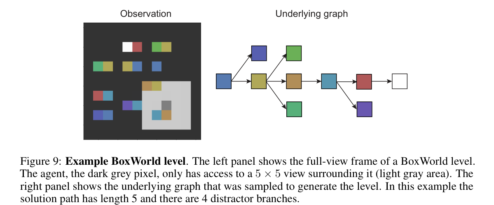
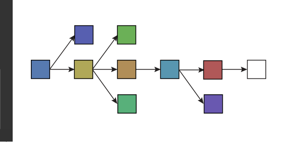

# Page 15 of 18 - Relational Recurrent Neural Networks

> Page 15 of the source PDF, verbatim as extracted. Canonical document: [18 - Relational Recurrent Neural Networks](../../papers/18-relational-recurrent-neural-networks.md)

Figure 8: Programmatic results. From left to right: full program, addition, control. The top row depicts per character accuracy scores from tasks with nesting = 2 and literal length = 5 while the bottom row shows scores from more difficult tasks with nesting = 3 and literal length = 6.

Underlying graph Observation

Figure 9: Example BoxWorld level. The left panel shows the full-view frame of a BoxWorld level. The agent, the dark grey pixel, only has access to a 5 × 5 view surrounding it (light gray area). The right panel shows the underlying graph that was sampled to generate the level. In this example the solution path has length 5 and there are 4 distractor branches.

key currently in possession. The goal of the task is to navigate the space, observe the key-lock combinations, and then choose the correct key-lock sequence so as to eventually receive the rewarded gem, denoted by a white pixel.

In each level there is a unique sequence of keys-lock pairs that should be traversed to reach the gem. There are a few important factors that make this task difficult: First, keys disappear once they are used. Since we include ‘distractor’ branches (i.e., key lock paths that lead to a dead end), the agent must be able to look ahead, and

reason about the appropriate path forward to the gem so as to not get stuck. Second, the location of the keys and locks are randomised, making this task completely devoid of any spatial biases. This emphasises a capacity to reason about the relations between keys and locks, in memory, based on their abstract relations, rather than based on their spatial positions. For this reason we suspect that CNN-based approaches may struggle, since their inductive biases are tied to relating things proximal in space.

To collect a locked key the agent must be in possession of the matching key color (only one key can be held at a time) and walk over the lock, after which the lock disappears. Only then is it possible for the agent to pick up the adjacent key. Each level was procedurally generated, constrained to have only one unique sequence in each level ending with the white gem. To generate the level we first sampled a random graph (tree) that defined the possible paths that could be traversed, including distractor paths. An example path is shown in figure 9.

---

[previous page](page-014.md) · [next page](page-016.md) · [all pages](index.md)
