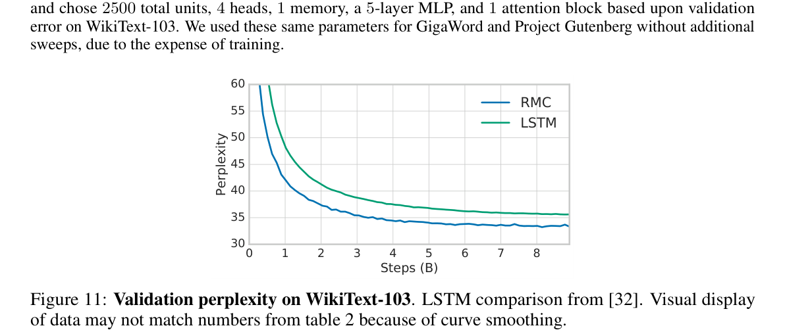
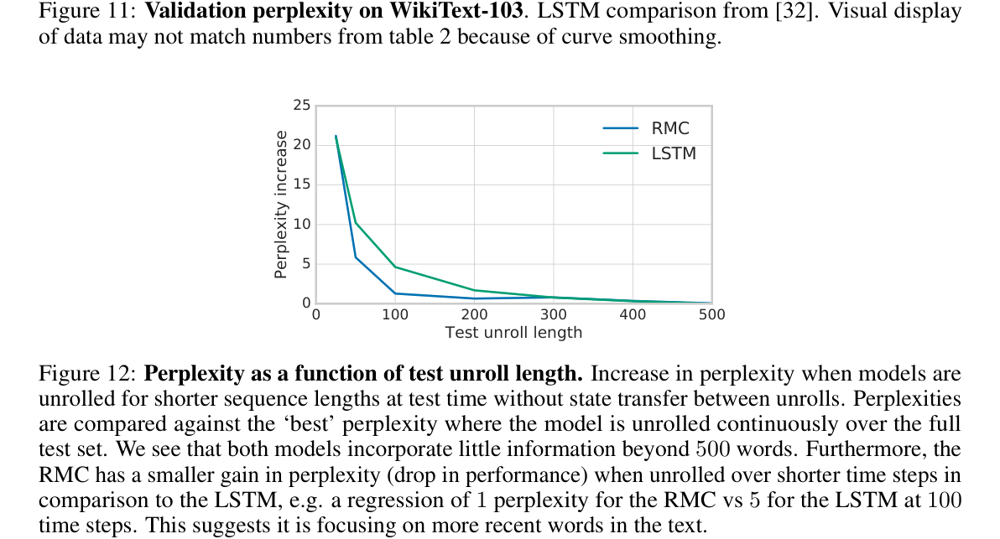

# Page 17 of 18 - Relational Recurrent Neural Networks

> Page 17 of the source PDF, verbatim as extracted. Canonical document: [18 - Relational Recurrent Neural Networks](../../papers/18-relational-recurrent-neural-networks.md)

• Number of memories {1, 2}

• MLP layers {1, 2, 3, 4, 5}

• Attention blocks {1, 2, 3, 4}

and chose 2500 total units, 4 heads, 1 memory, a 5-layer MLP, and 1 attention block based upon validation error on WikiText-103. We used these same parameters for GigaWord and Project Gutenberg without additional sweeps, due to the expense of training.

60

RMC LSTM

55

50

Perplexity

45

40

35

30

0 1 2 3 4 5 6 7 8 Steps (B)

Figure 11: Validation perplexity on WikiText-103. LSTM comparison from \[32\]. Visual display of data may not match numbers from table 2 because of curve smoothing.

25

RMC LSTM

Perplexity increase

20

15

10

5

0

0 100 200 300 400 500 Test unroll length

Figure 12: Perplexity as a function of test unroll length. Increase in perplexity when models are unrolled for shorter sequence lengths at test time without state transfer between unrolls. Perplexities are compared against the ‘best’ perplexity where the model is unrolled continuously over the full test set. We see that both models incorporate little information beyond 500 words. Furthermore, the RMC has a smaller gain in perplexity (drop in performance) when unrolled over shorter time steps in comparison to the LSTM, e.g. a regression of 1 perplexity for the RMC vs 5 for the LSTM at 100 time steps. This suggests it is focusing on more recent words in the text.

Table 3: Test perplexity split by word frequency on GigaWord v5. Words are bucketed by the number of times they occur in training set, > 10K contains the most frequent words.

> 10K 10K-1K < 1K All

LSTM \[32\] 39.4 6.5e3 3.7e4 53.5 LSTM + Hebbian Softmax \[32\] 33.2 3.2e3 1.6e4 43.7 RMC 28.3 3.1e3 6.9e4 38.3

---

[previous page](page-016.md) · [next page](page-018.md) · [all pages](index.md)
