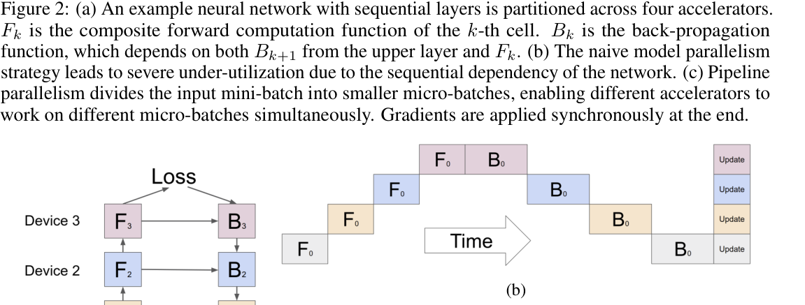
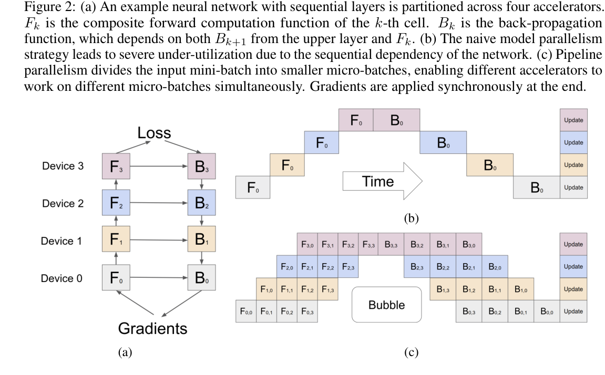
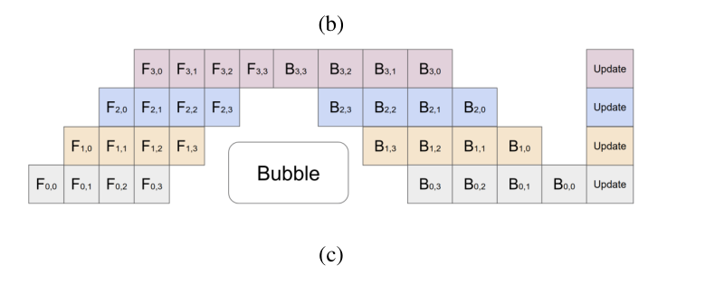

# Page 2 of 11 - GPipe: Easy Scaling with Micro-Batch Pipeline Parallelism

> Page 2 of the source PDF, verbatim as extracted. Canonical document: [19 - GPipe: Easy Scaling with Micro-Batch Pipeline Parallelism](../../papers/19-gpipe-pipeline-parallelism.md)

Figure 2: (a) An example neural network with sequential layers is partitioned across four accelerators. Fk is the composite forward computation function of the k-th cell. Bk is the back-propagation function, which depends on both Bk+1 from the upper layer and Fk. (b) The naive model parallelism strategy leads to severe under-utilization due to the sequential dependency of the network. (c) Pipeline parallelism divides the input mini-batch into smaller micro-batches, enabling different accelerators to work on different micro-batches simultaneously. Gradients are applied synchronously at the end.

(b)

(a)

(c)

## 2.1 Interface

Any deep neural network can be defined as a sequence of L layers. Each layer Li is composed of a forward computation function fi, and a corresponding set of parameters wi. GPipe additionally allows the user to specify an optional computation cost estimation function, ci. With a given number of partitions K, the sequence of L layers can be partitioned into K composite layers, or cells. Let pk consist of consecutive layers between layers i and j. The set of parameters corresponding to pk is equivalent to the union of wi, wi+1, . . . , wj, and its forward function would be Fk = fj◦. . .◦fi+1◦fi. The corresponding back-propagation function Bk can be computed from Fk using automatic symbolic differentiation. The cost estimator, Ck, is set to Σj

l=icl.

The GPipe interface is extremely simple and intuitive, requiring the user to specify: (i) the number of model partitions K, (ii) the number of micro-batches M, and (iii) the sequence and definitions of L layers that define the model. Please refer to supplementary material for examples.

## 2.2 Algorithm

Once the user defines the sequence of layers in their network in terms of model parameters wi, forward computation function fi, and the cost estimation function ci, GPipe partitions the network into K cells and places the k-th cell on the k-th accelerator. Communication primitives are automatically inserted at partition boundaries to allow data transfer between neighboring partitions. The partitioning algorithm minimizes the variance in the estimated costs of all cells in order to maximize the efficiency of the pipeline by syncing the computation time across all partitions.

During the forward pass, GPipe first divides every mini-batch of size N into M equal micro-batches, which are pipelined through the K accelerators. During the backward pass, gradients for each micro-batch are computed based on the same model parameters used for the forward pass. At the end of each mini-batch, gradients from all M micro-batches are accumulated and applied to update the model parameters across all accelerators. This sequence of operations is illustrated in Figure 2c.

If batch normalization \[20\] is used in the network, the sufficient statistics of inputs during training are computed over each micro-batch and over replicas if necessary \[21\]. We also track the moving average of the sufficient statistics over the entire mini-batch to be used during evaluation.

---

[previous page](page-001.md) · [next page](page-003.md) · [all pages](index.md)
