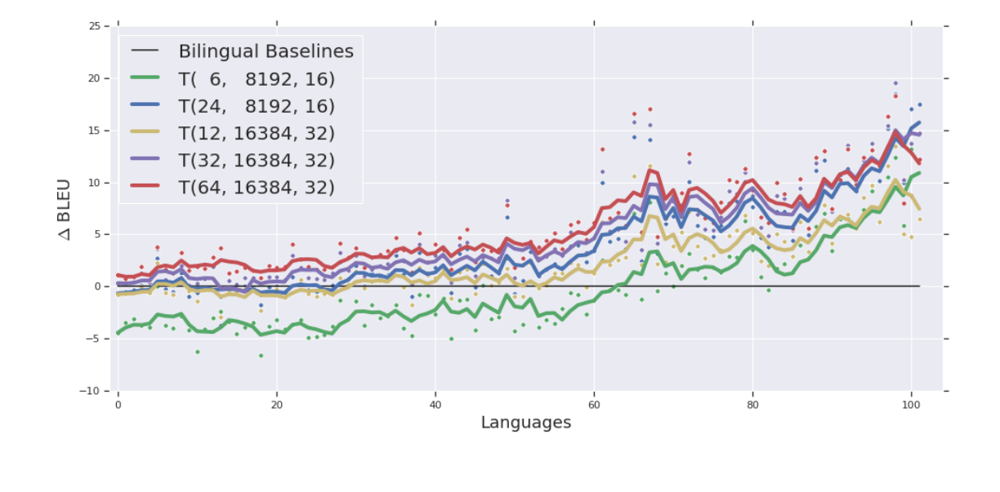

# Page 6 of 11 - GPipe: Easy Scaling with Micro-Batch Pipeline Parallelism

> Page 6 of the source PDF, verbatim as extracted. Canonical document: [19 - GPipe: Easy Scaling with Micro-Batch Pipeline Parallelism](../../papers/19-gpipe-pipeline-parallelism.md)

From Figure 3, we can observe that increasing the model capacity from 400M to 1.3B parameters significantly improves performance across all languages. Scaling up the model from 1.3B parameters to 6B parameters shows further improvement, especially for high-resource languages, although diminishing returns can be observed when scaling the model from 1.3B to 3B and 6B parameters.

Below we discuss some of our empirical findings based on these large-scale experiments.

Figure 3: Translation quality across all languages with increasing multilingual model capacity. Languages are arranged in the order of decreasing training dataset size from left to right. T(L, H, A), depicts the performance of a Transformer with L encoder and L decoder layers, a feed-forward hidden dimension of H and A attention heads. We notice that increasing the model capacity, from 400M params (T(6, 8192, 16)) to 1.3B (T(24, 8192, 16)), and further, to 6B (T(64, 16384, 32)), leads to significant quality improvements across all languages. We also notice huge quality improvements for low-resource languages (right side of the plot), when compared against bilingual baselines, highlighting the significant transfer gains resulting from training a multilingual model.

Depth-Width Trade-off: We study the trade-off between depth and width in our multilingual setup and compare the performance of 1.3B wide model T(12, 16384, 32) and 1.3B deep model T(24, 8192, 16). While the quality of these two models on high-resource languages (left of Figure 3) is very similar, the deeper model outperforms by huge margins on low-resource languages, suggesting that increasing model depth might be better for generalization. Further, the quality improvements for low-resource languages (right side of Figure 3), when comparing the 1.3B deep model against the 400M model, are almost as large as the improvements for high-resource languages, indicating that increasing depth might potentially increase the extent of transfer to low-resource tasks.

Trainability Challenges with Deep Models: Although depth increases the representational capacity of neural networks, it also complicates the optimization problem. In our large-scale experiments, we encountered severe trainability issues arising from a combination of sharp activations (positive kurtosis) and dataset noise. We observed that after training for a few thousand steps, the model predictions would become extremely peaky and vulnerable to noise, which frequently resulted in non-finite or large gradients that eventually destroyed the learning progress. To counter these problems, we apply two methods: (i) Following Zhang et al. \[38\], we scale down the initialization of all transformer feed-forward layers by the number of layers. (ii) We clip the logit predictions (softmax pre-activations) whenever their magnitude exceeds a certain value.

A combination of these two approaches allows us to mitigate the training instability posed by scaling model depth.

Table 5: The Effect of Batch Size

Large Batches: Due to its simplicity, data parallelism is the dominant approach to scale neural network training\[39, 40\]. We test the limits of large-batch training by significantly increasing the batch size used for standard Transformer Big training. Starting from 260K tokens per batch,

Batch Size 260K 1M 4M BLEU 30.92 31.86 32.71 Loss (NLL) 2.58 2.51 2.46

---

[previous page](page-005.md) · [next page](page-007.md) · [all pages](index.md)
