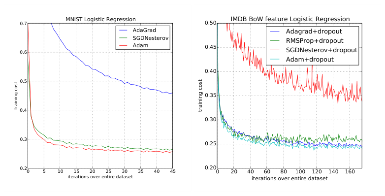

# Page 5 of 15 - Adam: A Method for Stochastic Optimization

> Page 5 of the source PDF, verbatim as extracted. Canonical document: [20 - Adam: A Method for Stochastic Optimization](../../papers/20-adam-stochastic-optimization.md)

Published as a conference paper at ICLR 2015

IMDB BoW feature Logistic Regression

MNIST Logistic Regression

0.50

0.7

Adagrad+dropout RMSProp+dropout SGDNesterov+dropout Adam+dropout

AdaGrad SGDNesterov Adam

0.45

0.6

0.40

0.5

training cost

training cost

0.35

0.4

0.30

0.3

0.25

0.20

0.2

0 20 40 60 80 100 120 140 160 iterations over entire dataset

0 5 10 15 20 25 30 35 40 45 iterations over entire dataset

Figure 1: Logistic regression training negative log likelihood on MNIST images and IMDB movie reviews with 10,000 bag-of-words (BoW) feature vectors.

training to prevent over-fitting. In figure 1, Adagrad outperforms SGD with Nesterov momentum by a large margin both with and without dropout noise. Adam converges as fast as Adagrad. The empirical performance of Adam is consistent with our theoretical findings in sections 2 and 4. Similar to Adagrad, Adam can take advantage of sparse features and obtain faster convergence rate than normal SGD with momentum.

6.2 EXPERIMENT: MULTI-LAYER NEURAL NETWORKS

Multi-layer neural network are powerful models with non-convex objective functions. Although our convergence analysis does not apply to non-convex problems, we empirically found that Adam often outperforms other methods in such cases. In our experiments, we made model choices that are consistent with previous publications in the area; a neural network model with two fully connected hidden layers with 1000 hidden units each and ReLU activation are used for this experiment with minibatch size of 128.

First, we study different optimizers using the standard deterministic cross-entropy objective function with L2 weight decay on the parameters to prevent over-fitting. The sum-of-functions (SFO) method (Sohl-Dickstein et al., 2014) is a recently proposed quasi-Newton method that works with minibatches of data and has shown good performance on optimization of multi-layer neural networks. We used their implementation and compared with Adam to train such models. Figure 2 shows that Adam makes faster progress in terms of both the number of iterations and wall-clock time. Due to the cost of updating curvature information, SFO is 5-10x slower per iteration compared to Adam, and has a memory requirement that is linear in the number minibatches.

Stochastic regularization methods, such as dropout, are an effective way to prevent over-fitting and often used in practice due to their simplicity. SFO assumes deterministic subfunctions, and indeed failed to converge on cost functions with stochastic regularization. We compare the effectiveness of Adam to other stochastic first order methods on multi-layer neural networks trained with dropout noise. Figure 2 shows our results; Adam shows better convergence than other methods.

6.3 EXPERIMENT: CONVOLUTIONAL NEURAL NETWORKS

Convolutional neural networks (CNNs) with several layers of convolution, pooling and non-linear units have shown considerable success in computer vision tasks. Unlike most fully connected neural nets, weight sharing in CNNs results in vastly different gradients in different layers. A smaller learning rate for the convolution layers is often used in practice when applying SGD. We show the effectiveness of Adam in deep CNNs. Our CNN architecture has three alternating stages of 5x5 convolution filters and 3x3 max pooling with stride of 2 that are followed by a fully connected layer of 1000 rectified linear hidden units (ReLU’s). The input image are pre-processed by whitening, and

6

---

[previous page](page-004.md) · [next page](page-006.md) · [all pages](index.md)
