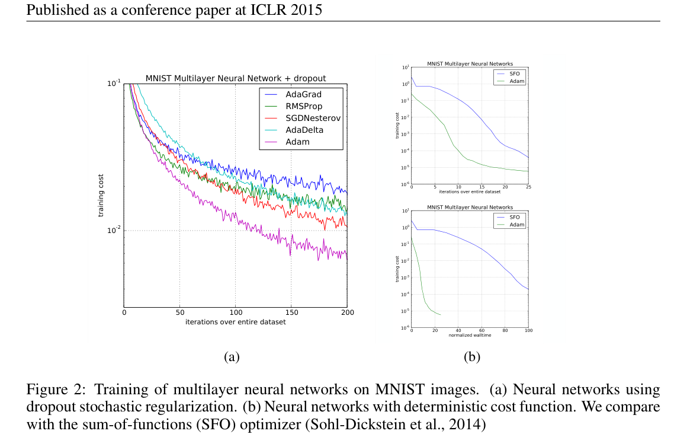
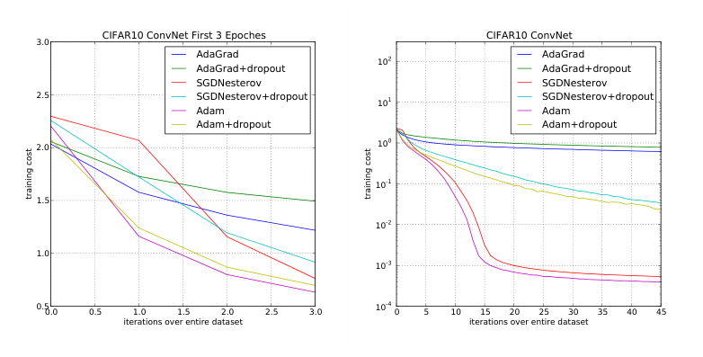

# Page 6 of 15 - Adam: A Method for Stochastic Optimization

> Page 6 of the source PDF, verbatim as extracted. Canonical document: [20 - Adam: A Method for Stochastic Optimization](../../papers/20-adam-stochastic-optimization.md)

Published as a conference paper at ICLR 2015

MNIST Multilayer Neural Network + dropout

10 -1

AdaGrad RMSProp SGDNesterov AdaDelta Adam

training cost

10 -2

0 50 100 150 200 iterations over entire dataset

(a) (b)

Figure 2: Training of multilayer neural networks on MNIST images. (a) Neural networks using dropout stochastic regularization. (b) Neural networks with deterministic cost function. We compare with the sum-of-functions (SFO) optimizer (Sohl-Dickstein et al., 2014)

CIFAR10 ConvNet First 3 Epoches

CIFAR10 ConvNet

3.0

AdaGrad AdaGrad+dropout SGDNesterov SGDNesterov+dropout Adam Adam+dropout

AdaGrad AdaGrad+dropout SGDNesterov SGDNesterov+dropout Adam Adam+dropout

102

2.5

101

100

2.0

training cost

training cost

10-1

1.5

10-2

1.0

10-3

10-4

0.5

0.0 0.5 1.0 1.5 2.0 2.5 3.0 iterations over entire dataset

0 5 10 15 20 25 30 35 40 45 iterations over entire dataset

Figure 3: Convolutional neural networks training cost. (left) Training cost for the first three epochs. (right) Training cost over 45 epochs. CIFAR-10 with c64-c64-c128-1000 architecture.

dropout noise is applied to the input layer and fully connected layer. The minibatch size is also set to 128 similar to previous experiments.

Interestingly, although both Adam and Adagrad make rapid progress lowering the cost in the initial stage of the training, shown in Figure 3 (left), Adam and SGD eventually converge considerably faster than Adagrad for CNNs shown in Figure 3 (right). We notice the second moment estimate bvt vanishes to zeros after a few epochs and is dominated by the ϵ in algorithm 1. The second moment estimate is therefore a poor approximation to the geometry of the cost function in CNNs comparing to fully connected network from Section 6.2. Whereas, reducing the minibatch variance through the first moment is more important in CNNs and contributes to the speed-up. As a result, Adagrad converges much slower than others in this particular experiment. Though Adam shows marginal improvement over SGD with momentum, it adapts learning rate scale for different layers instead of hand picking manually as in SGD.

7

---

[previous page](page-005.md) · [next page](page-007.md) · [all pages](index.md)
