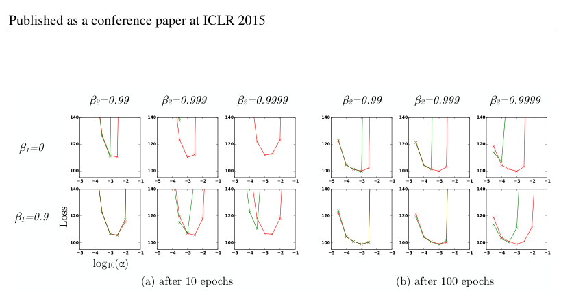

# Page 7 of 15 - Adam: A Method for Stochastic Optimization

> Page 7 of the source PDF, verbatim as extracted. Canonical document: [20 - Adam: A Method for Stochastic Optimization](../../papers/20-adam-stochastic-optimization.md)

Published as a conference paper at ICLR 2015

β2=0.99 β2=0.999 β2=0.9999 β2=0.99 β2=0.999 β2=0.9999

β1=0

Loss

β1=0.9

log10(α)

(a) after 10 epochs (b) after 100 epochs

Figure 4: Effect of bias-correction terms (red line) versus no bias correction terms (green line) after 10 epochs (left) and 100 epochs (right) on the loss (y-axes) when learning a Variational AutoEncoder (VAE) (Kingma & Welling, 2013), for different settings of stepsize α (x-axes) and hyperparameters β1 and β2.

6.4 EXPERIMENT: BIAS-CORRECTION TERM

We also empirically evaluate the effect of the bias correction terms explained in sections 2 and 3. Discussed in section 5, removal of the bias correction terms results in a version of RMSProp (Tieleman & Hinton, 2012) with momentum. We vary the β1 and β2 when training a variational autoencoder (VAE) with the same architecture as in (Kingma & Welling, 2013) with a single hidden layer with 500 hidden units with softplus nonlinearities and a 50-dimensional spherical Gaussian latent variable. We iterated over a broad range of hyper-parameter choices, i.e. β1 ∈\[0, 0.9\] and β2 ∈\[0.99, 0.999, 0.9999\], and log10(α) ∈\[−5, ..., −1\]. Values of β2 close to 1, required for robustness to sparse gradients, results in larger initialization bias; therefore we expect the bias correction term is important in such cases of slow decay, preventing an adverse effect on optimization.

In Figure 4, values β2 close to 1 indeed lead to instabilities in training when no bias correction term was present, especially at first few epochs of the training. The best results were achieved with small values of (1−β2) and bias correction; this was more apparent towards the end of optimization when gradients tends to become sparser as hidden units specialize to specific patterns. In summary, Adam performed equal or better than RMSProp, regardless of hyper-parameter setting.

## 7 EXTENSIONS

7.1 ADAMAX

In Adam, the update rule for individual weights is to scale their gradients inversely proportional to a (scaled) L2 norm of their individual current and past gradients. We can generalize the L2 norm based update rule to a Lp norm based update rule. Such variants become numerically unstable for large p. However, in the special case where we let p →∞, a surprisingly simple and stable algorithm emerges; see algorithm 2. We’ll now derive the algorithm. Let, in case of the Lp norm, the stepsize at time t be inversely proportional to v1/p

t , where:

vt = βp

2vt−1 + (1 −βp 2)|gt|p (6)

t X

βp(t−i)

= (1 −βp

2 · |gi|p (7)

2)

i=1

8

---

[previous page](page-006.md) · [next page](page-008.md) · [all pages](index.md)
