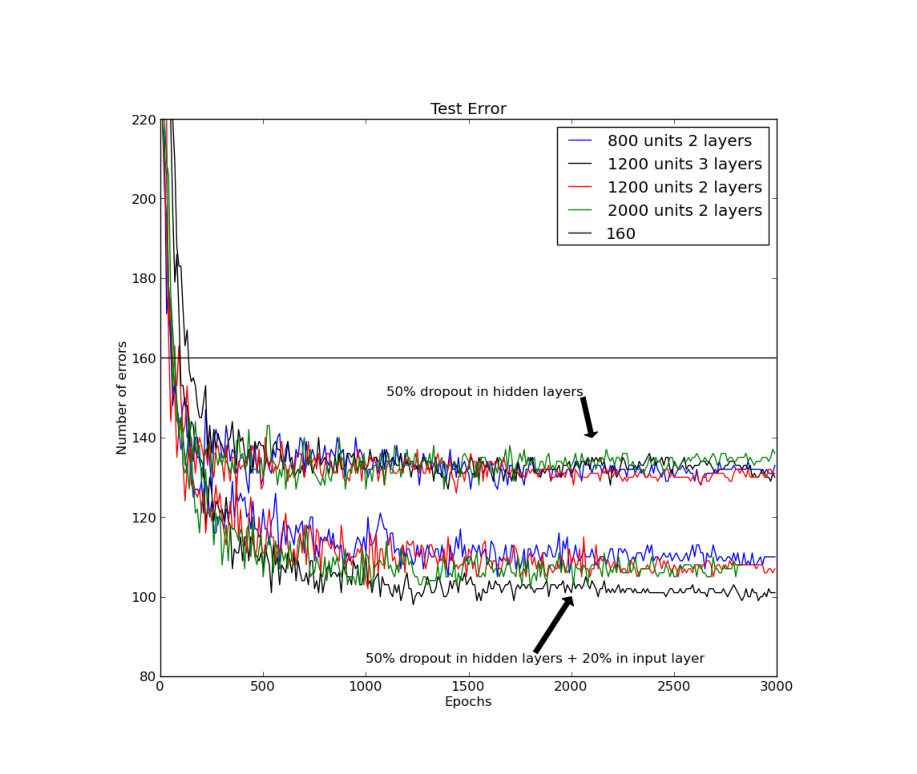

# Page 2 of 18 - Dropout: A Simple Way to Prevent Neural Networks from Overfitting

> Page 2 of the source PDF, verbatim as extracted. Canonical document: [21 - Dropout: A Simple Way to Prevent Neural Networks from Overfitting](../../papers/21-dropout-regularization.md)

Fig. 1: The error rate on the MNIST test set for a variety of neural network architectures trained with backpropagation using 50% dropout for all hidden layers. The lower set of lines also use 20% dropout for the input layer. The best previously published result for this task using backpropagation without pre-training or weight-sharing or enhancements of the training set is shown as a horizontal line.

train a deep Boltzmann machine five times, the unrolled network got 103, 97, 94, 93 and 88 errors when fine-tuned using standard backpropagation and 83, 79, 78, 78 and 77 errors when using 50% dropout of the hidden units. The mean of 79 errors is a record for methods that do not use prior knowledge or enhanced training sets (For details see Appendix A).

We then applied dropout to TIMIT, a widely used benchmark for recognition of clean speech with a small vocabulary. Speech recognition systems use hidden Markov models (HMMs) to deal with temporal variability and they need an acoustic model that determines how well a frame of coefficients extracted from the acoustic input fits each possible state of each hidden Markov model. Recently, deep, pre-trained, feedforward neural networks that map a short sequence of frames into a probability distribution over HMM states have been shown to outperform tradional Gaussian mixture models on both TIMIT (6) and a variety of more realistic large vocabulary tasks (7,8).

Figure 2 shows the frame classification error rate on the core test set of the TIMIT benchmark when the central frame of a window is classified as belonging to the HMM state that is given the highest probability by the neural net. The input to the net is 21 adjacent frames with an advance of 10ms per frame. The neural net has 4 fully-connected hidden layers of 4000 units per

3

---

[previous page](page-001.md) · [next page](page-003.md) · [all pages](index.md)
