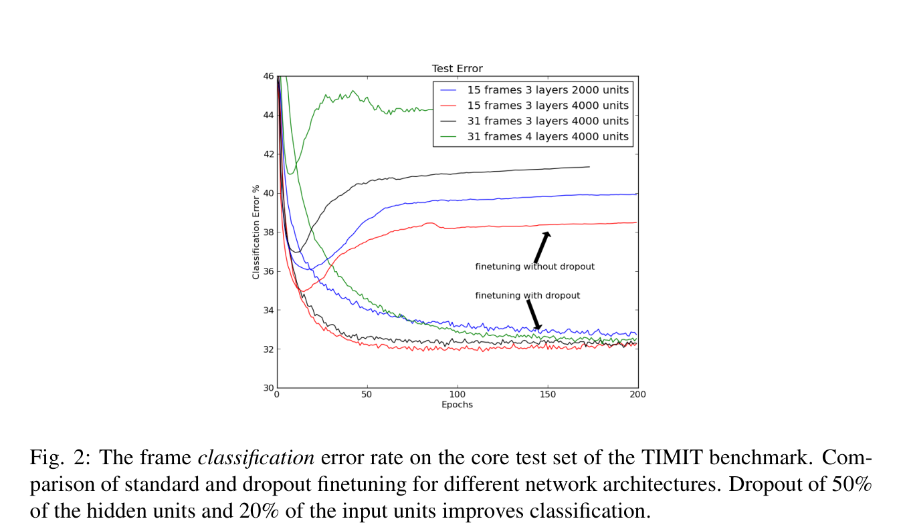

# Page 3 of 18 - Dropout: A Simple Way to Prevent Neural Networks from Overfitting

> Page 3 of the source PDF, verbatim as extracted. Canonical document: [21 - Dropout: A Simple Way to Prevent Neural Networks from Overfitting](../../papers/21-dropout-regularization.md)

Fig. 2: The frame classification error rate on the core test set of the TIMIT benchmark. Comparison of standard and dropout finetuning for different network architectures. Dropout of 50% of the hidden units and 20% of the input units improves classification.

layer and 185 “softmax” output units that are subsequently merged into the 39 distinct classes used for the benchmark. Dropout of 50% of the hidden units significantly improves classification for a variety of different network architectures (see figure 2). To get the frame recognition rate, the class probabilities that the neural network outputs for each frame are given to a decoder which knows about transition probabilities between HMM states and runs the Viterbi algorithm to infer the single best sequence of HMM states. Without dropout, the recognition rate is 22.7% and with dropout this improves to 19.7%, which is a record for methods that do not use any information about speaker identity.

CIFAR-10 is a benchmark task for object recognition. It uses 32x32 downsampled color images of 10 different object classes that were found by searching the web for the names of the class (e.g. dog) or its subclasses (e.g. Golden Retriever). These images were labeled by hand to produce 50,000 training images and 10,000 test images in which there is a single dominant object that could plausibly be given the class name (9) (see figure 3). The best published error rate on the test set, without using transformed data, is 18.5% (10). We achieved an error rate of 16.6% by using a neural network with three convolutional hidden layers interleaved with three “max-pooling” layers that report the maximum activity in local pools of convolutional units. These six layers were followed by one locally-connected layer (For details see Appendix D) . Using dropout in the last hidden layer gives an error rate of 15.6%.

ImageNet is an extremely challenging object recognition dataset consisting of thousands of high-resolution images of thousands of classes of object (11). In 2010, a subset of 1000 classes with roughly 1000 examples per class was the basis of an object recognition competition in

4

---

[previous page](page-002.md) · [next page](page-004.md) · [all pages](index.md)
