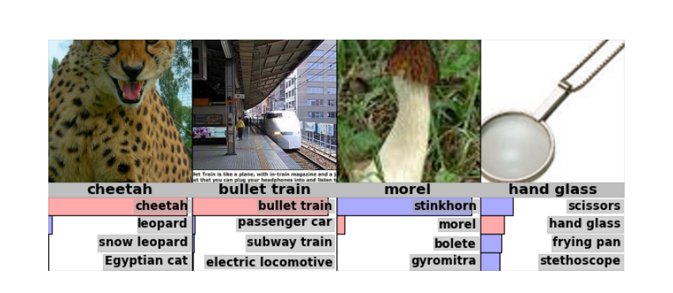

# Page 4 of 18 - Dropout: A Simple Way to Prevent Neural Networks from Overfitting

> Page 4 of the source PDF, verbatim as extracted. Canonical document: [21 - Dropout: A Simple Way to Prevent Neural Networks from Overfitting](../../papers/21-dropout-regularization.md)

Fig. 3: Ten examples of the class “bird” from the CIFAR-10 test set illustrating the variety of types of bird, viewpoint, lighting and background. The neural net gets all but the last two examples correct.

which the winning entry, which was actually an average of six separate models, achieved an error rate of 47.2% on the test set. The current state-of-the-art result on this dataset is 45.7% (12). We achieved comparable performance of 48.6% error using a single neural network with five convolutional hidden layers interleaved with “max-pooling” layer followed by two globally connected layers and a final 1000-way softmax layer. All layers had L2 weight constraints on the incoming weights of each hidden unit. Using 50% dropout in the sixth hidden layer reduces this to a record 42.4% (For details see Appendix E).

For the speech recognition dataset and both of the object recognition datasets it is necessary to make a large number of decisions in designing the architecture of the net. We made these decisions by holding out a separate validation set that was used to evaluate the performance of a large number of different architectures and we then used the architecture that performed best with dropout on the validation set to assess the performance of dropout on the real test set.

The Reuters dataset contains documents that have been labeled with a hierarchy of classes. We created training and test sets each containing 201,369 documents from 50 mutually exclusive classes. Each document was represented by a vector of counts for 2000 common non-stop words, with each count C being transformed to log(1+C). A feedforward neural network with 2 fully connected layers of 2000 hidden units trained with backpropagation gets 31.05% error on the test set. This is reduced to 29.62% by using 50% dropout (Appendix C).

We have tried various dropout probabilities and almost all of them improve the generalization performance of the network. For fully connected layers, dropout in all hidden layers works better than dropout in only one hidden layer and more extreme probabilities tend to be worse, which is why we have used 0.5 throughout this paper. For the inputs, dropout can also help,

Fig. 4: Some Imagenet test cases with the probabilities of the best 5 labels underneath. Many of the top 5 labels are quite plausible.

5

---

[previous page](page-003.md) · [next page](page-005.md) · [all pages](index.md)
