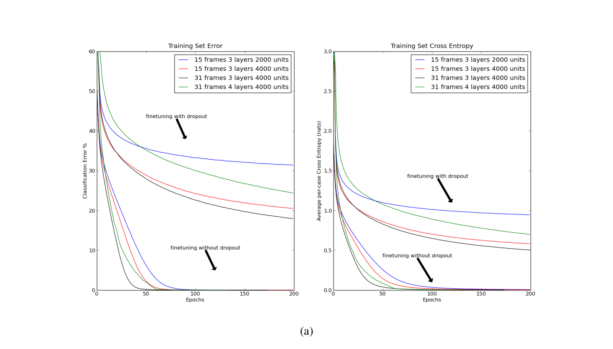
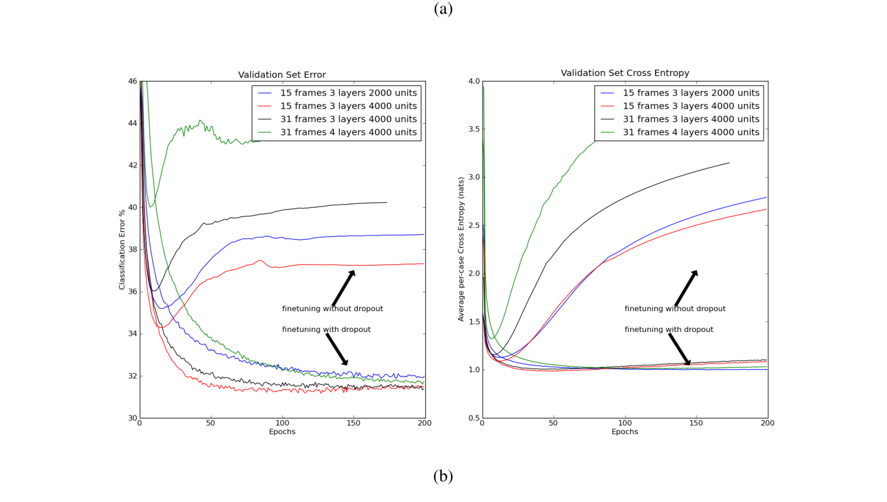

# Page 10 of 18 - Dropout: A Simple Way to Prevent Neural Networks from Overfitting

> Page 10 of the source PDF, verbatim as extracted. Canonical document: [21 - Dropout: A Simple Way to Prevent Neural Networks from Overfitting](../../papers/21-dropout-regularization.md)

(a)

(b)

Fig. 6: Frame classification error and cross-entropy on the (a) Training and (b) Validation set as learning progresses. The training error is computed using the stochastic nets.

11

---

[previous page](page-009.md) · [next page](page-011.md) · [all pages](index.md)
