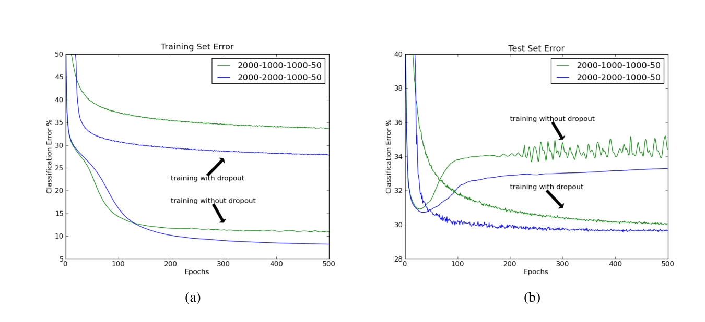
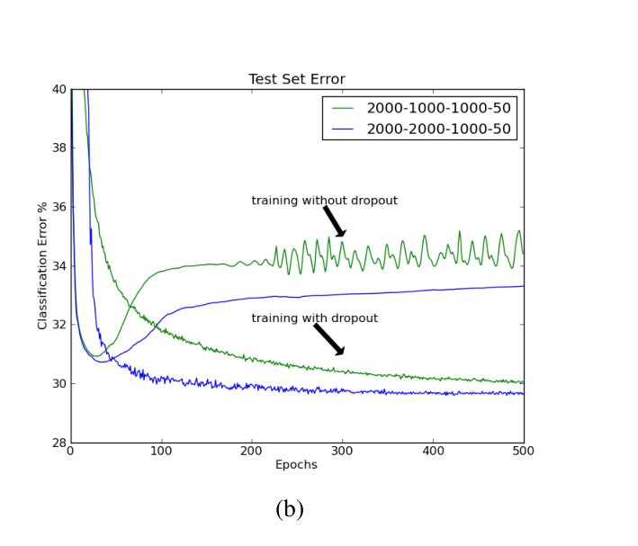

# Page 12 of 18 - Dropout: A Simple Way to Prevent Neural Networks from Overfitting

> Page 12 of the source PDF, verbatim as extracted. Canonical document: [21 - Dropout: A Simple Way to Prevent Neural Networks from Overfitting](../../papers/21-dropout-regularization.md)

that had only 4 training examples. We also removed one category that covered a huge chunk (25%) of the examples. This left us with 50 classes and 402,738 documents. We divided the documents into equal-sized training and test sets randomly. Each document was represented using the 2000 most frequent non-stopwords in the dataset.

(a)

(b)

Fig. 7: Classification error rate on the (a) training and (b) validation sets of the Reuters dataset as learning progresses. The training error is computed using the stochastic nets.

We trained a neural network using dropout-backpropagation and compared it with standard backpropagation. We used a 2000-2000-1000-50 architecture. The training hyperparameters are same as that in MNIST dropout training (Appendix A.1). Training was done for 500 epochs.

Figure 7 shows the training and test set errors as learning progresses. We show two nets - one with a 2000-2000-1000-50 and another with a 2000-1000-1000-50 architecture trained with and without dropout. As in all previous datasets discussed so far, we obtain significant improvements here too. The learning not only results in better generalization, but also proceeds smoothly, without the need for early stopping.

## D Tiny Images and CIFAR-10

The Tiny Images dataset contains 80 million 32 × 32 color images collected from the web. The images were found by searching various image search engines for English nouns, so each image comes with a very unreliable label, which is the noun that was used to find it. The CIFAR-10 dataset is a subset of the Tiny Images dataset which contains 60000 images divided among ten classes5. Each class contains 5000 training images and 1000 testing images. The classes are

5The CIFAR dataset is available at http://www.cs.toronto.edu/∼kriz/cifar.html.

13

---

[previous page](page-011.md) · [next page](page-013.md) · [all pages](index.md)
