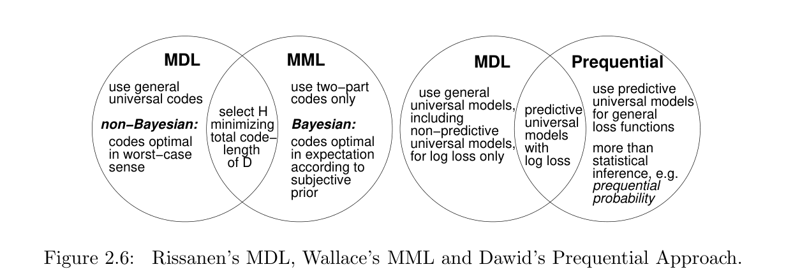

# Page 66 of 80 - A Tutorial Introduction to the Minimum Description Length Principle

> Page 66 of the source PDF, verbatim as extracted. Canonical document: [24 - A Tutorial Introduction to the Minimum Description Length Principle](../../papers/24-tutorial-minimum-description-length.md)

## MDL MML

## MDL Prequential

universal codes codes only use two−part

use general

use predictive universal models for general loss functions

use general

universal models,

predictive universal models with log loss

select H

universal models, non−predictive including

total code− minimizing

## non−Bayesian:

## Bayesian:

according to in expectation codes optimal codes optimal in worst−case sense

statistical more than

length

for log loss only

of D

inference, e.g. prequential probability

subjective prior

Figure 2.6: Rissanen’s MDL, Wallace’s MML and Dawid’s Prequential Approach.

Indeed, Wallace and his co-workers stress that their approach is fully (subjective) Bayesian. Strictly speaking, a Bayesian should report his findings by citing the full posterior distribution. But sometimes one is interested in a single model, or hypothesis for the data. A good example is the inference of phylogenetic trees in biological applications: the full posterior would consist of a mixture of several of such trees, which might all be quite different from each other. Such a mixture is almost impossible to interpret – to get insight in the data we need a single tree. In that case, Bayesians often use the MAP (Maximum A Posteriori) hypothesis which maximizes the posterior, or the posterior mean parameter value. The first approach has some unpleasant properties, for example, it is not invariant under reparameterization. The posterior mean approach cannot be used if different model families are to be compared with each other. The MML method provides a theoretically sound way of proceeding in such cases.

2.9.3 MDL, Prequential Analysis and Cross-Validation

In a series of papers, A.P. Dawid \[1984, 1992, 1997\] put forward a methodology for probability and statistics based on sequential prediction which he called the prequential approach. When applied to model selection problems, it is closely related to MDL Dawid proposes to construct, for each model M(j) under consideration, a ‘probability forecasting system’ (a sequential prediction strategy) where the i + 1-st outcome is predicted based on either the Bayesian posterior ¯PBayes(θ|xi) or on some estimator

ˆθ(xi). Then the model is selected for which the associated sequential prediction strategy minimizes the accumulated prediction error. Related ideas were put forward by Hjorth \[1982\] under the name forward validation and Rissanen \[1984\]. From Section 2.6.4 we see that this is just a form of MDL - strictly speaking, every universal code can be thought of as as prediction strategy, but for the Bayesian and the plug-in universal models (Sections 2.6.3, 2.6.4) the interpretation is much more natural than for others20. Dawid mostly talks about such ‘predictive’ universal models. On the other hand, Dawid’s framework allows to adjust the prediction loss to be measured in terms of arbitrary loss functions, not just the log loss. In this sense, it is more general than MDL. Finally, the prequential idea goes beyond statistics: there is also a ‘prequential approach’ to probability theory developed by Dawid \[Dawid and Vovk 1999\] and Shafer

67

---

[previous page](page-065.md) · [next page](page-067.md) · [all pages](index.md)
