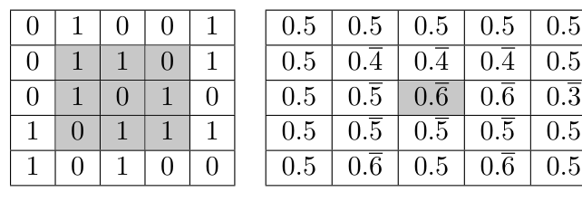
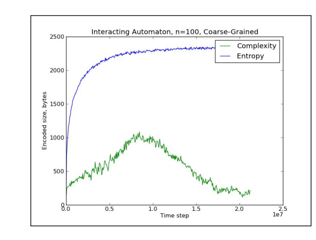
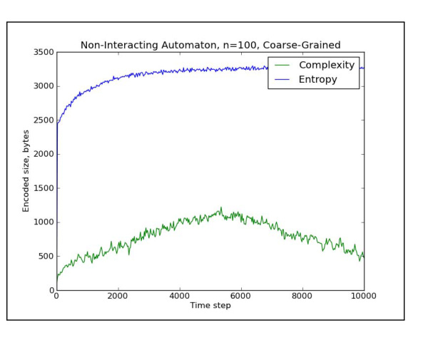

# Page 11 of 22 - Quantifying the Rise and Fall of Complexity in Closed Systems: The Coffee Automaton

> Page 11 of the source PDF, verbatim as extracted. Canonical document: [25 - Quantifying the Rise and Fall of Complexity in Closed Systems: The Coffee Automaton](../../papers/25-coffee-automaton.md)

Fine-Grained Coarse-Grained 0 1 0 0 1 0 1 1 0 1 0 1 0 1 0 1 0 1 1 1 1 0 1 0 0

0.5 0.5 0.5 0.5 0.5 0.5 0.4 0.4 0.4 0.5 0.5 0.5 0.6 0.6 0.3 0.5 0.5 0.5 0.5 0.5 0.5 0.6 0.5 0.6 0.5

Figure 1: Illustration of the construction of the coarse-grained array, using an example grain size of 3. The values of the shaded cells at left are averaged to produce the value of the shaded cell at right.

## 5 Coarse-Graining Experiment

## 5.1 Method

To derive a coarse-grained version of the automaton state from its original, fine-grained version, we construct a new array in which the value of each cell is the average of the values of the nearby cells in the fine-grained array. We define “nearby” cells as those within a g × g square centered at the cell in question. The value of g is called the grain size, and here is selected experimentally. This procedure is illustrated in Figure 1.

Given this array of averages, we then threshold its floating-point values into three buckets. Visually, these buckets represent areas which are mostly coffee (values close to 0), mostly cream (values close to 1), or mixed (values close to 0.5). The estimated complexity of the state, K (S), is the file size of the thresholded, coarse-grained array after compression. Analogously, the estimated entropy of the automaton state is the compressed file size of the fine-grained array.

## 5.2 Results and Analysis

Results from simulation of the automaton using the coarse-graining metric are shown in Figure 2.

Figure 2: The estimated entropy and complexity of an automaton using the coarse-graining metric. Results for the interacting model are shown at left, and results for the non-interacting model are at right.

12

---

[previous page](page-010.md) · [next page](page-012.md) · [all pages](index.md)
