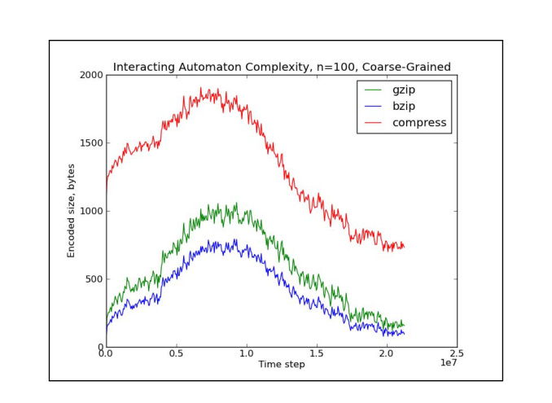
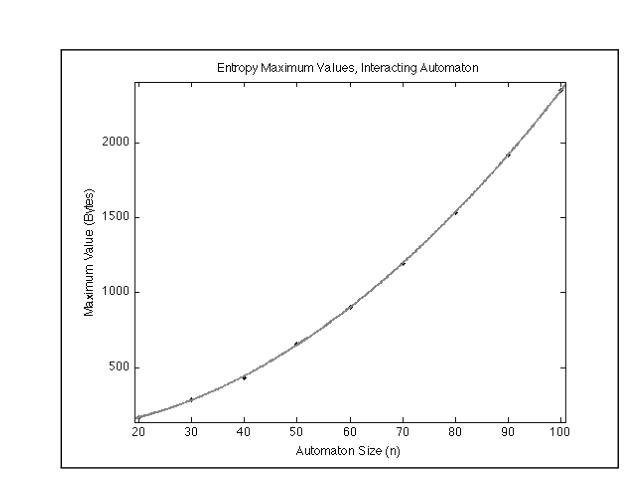
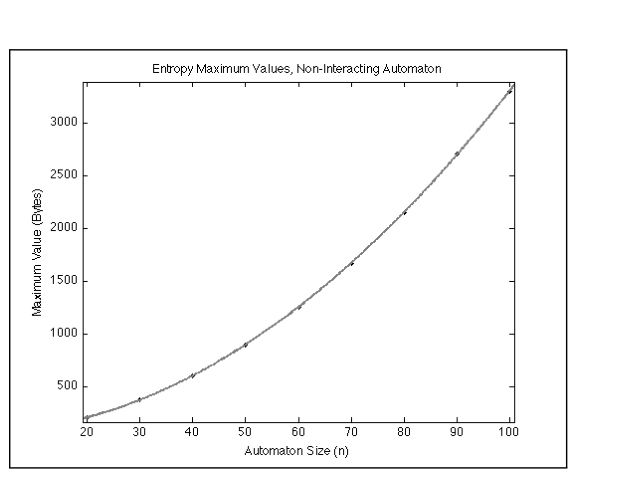

# Page 14 of 22 - Quantifying the Rise and Fall of Complexity in Closed Systems: The Coffee Automaton

> Page 14 of the source PDF, verbatim as extracted. Canonical document: [25 - Quantifying the Rise and Fall of Complexity in Closed Systems: The Coffee Automaton](../../papers/25-coffee-automaton.md)

Figure 5: Coarse-grained complexity estimates for a single simulation of the interacting automaton, using multiple file compression programs.

Figure 6: Graphs of automaton size versus entropy maximum value. Quadratic curve fits are shown, with r2 values of 0.9999 for both the interacting and non-interacting automaton.

could be removed by adjusting the fluctuating pixels. However, since each pixel can be adjusted independently, there are 2n2 possible ways to adjust a given coarse-grained array.

Because we cannot search through this exponential number of possible adjustments to find the optimal one, we develop an approximation algorithm to produce an adjustment that specifically targets pixels on the border between two thresholds. Given the properties of the automaton—it begins with rows of dark cells on top, and light cells on the bottom—it is likely that each row of the coarse-grained array will contain similar values. Thus, we adjust the coarse-grained array by using a majority algorithm. If a cell is within one threshold value of the majority value in its row, it is adjusted to the majority value.

The hope is that

(1) this adjustment will reduce artificial border complexity by “flattening” fluctuating border

rows to a single color,

(2) the adjustment will not eliminate actual complexity, since complicated structures will create

15

---

[previous page](page-013.md) · [next page](page-015.md) · [all pages](index.md)
