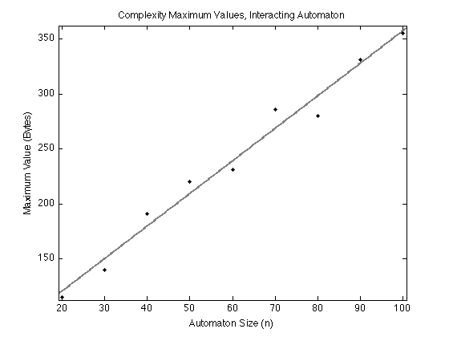
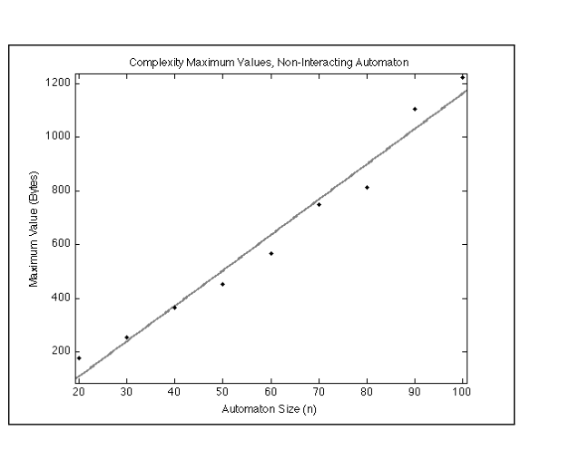
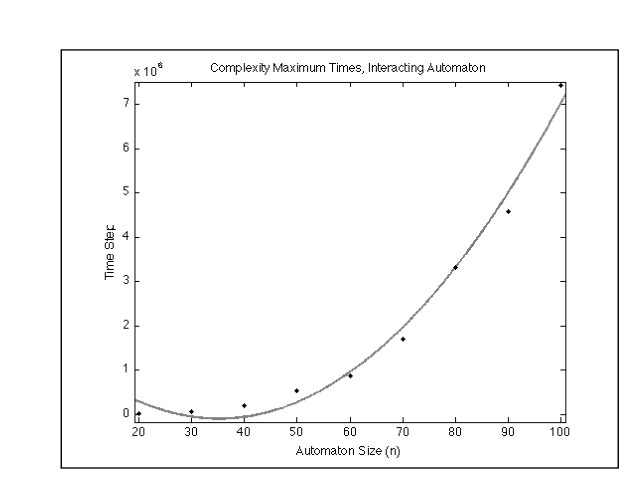
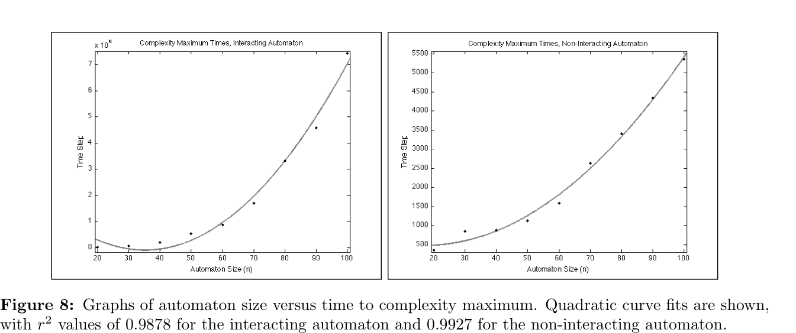

# Page 15 of 22 - Quantifying the Rise and Fall of Complexity in Closed Systems: The Coffee Automaton

> Page 15 of the source PDF, verbatim as extracted. Canonical document: [25 - Quantifying the Rise and Fall of Complexity in Closed Systems: The Coffee Automaton](../../papers/25-coffee-automaton.md)

Figure 7: Graphs of automaton size versus complexity maximum value. Linear curve fits are shown, with r2 values of 0.9798 for the interacting automaton and 0.9729 for the non-interacting automaton.

Figure 8: Graphs of automaton size versus time to complexity maximum. Quadratic curve fits are shown, with r2 values of 0.9878 for the interacting automaton and 0.9927 for the non-interacting automaton.

Figure 9: A coarse-grained array consisting of a smooth gradient from 0 to 1 is shown at left. At right is the same array after a small amount of simulated noise has been added and the values have been thresholded.

16

---

[previous page](page-014.md) · [next page](page-016.md) · [all pages](index.md)
