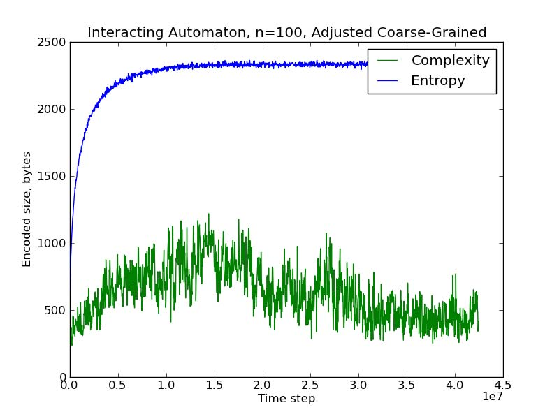
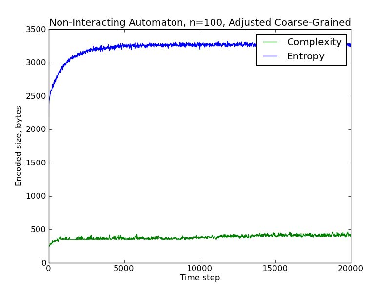

# Page 16 of 22 - Quantifying the Rise and Fall of Complexity in Closed Systems: The Coffee Automaton

> Page 16 of the source PDF, verbatim as extracted. Canonical document: [25 - Quantifying the Rise and Fall of Complexity in Closed Systems: The Coffee Automaton](../../papers/25-coffee-automaton.md)

Figure 10: The estimated entropy and complexity of an automaton using the adjusted coarse-graining metric.

value differences in the coarse-grained array that are large enough to span multiple thresholds.

## 6.2 Results and Analysis

Results from simulation of the automaton using the adjusted coarse-graining metric are shown in Figure 10. Visualizations of the automaton state are shown in Figures 11 and 12.

While this metric is somewhat noisier than the original coarse-graining method, it results in a similarly-shaped complexity curve for the interacting automaton. For the non-interacting automaton, however, the complexity curve is flattened to a lower value.

This result for the non-interacting automaton is actually borne out by theoretical predictions. The basic story is as follows; for details, see Appendix 9. If we consider the automaton state to “wrap around” from right to left, then by symmetry, the expected number of cream particles at a particular location in the automaton depends solely on the vertical position of that location. The expectations of all cells in a particular row will be the same, allowing the two-dimensional automaton state to be specified using a single dimension. Modeling each particle of cream as taking a random walk from its initial position, it is possible to calculate the expected number of particles at a given position as a function of time. Further, Chernoffbounds can be used to demonstrate that the actual number of particles in each grain of the coarse-grained state is likely to be close to the expectation, provided that the grain size is large enough. Since it is possible to specify the expected distribution of particles in the non-interacting automaton at all times using such a function, the complexity of the non-interacting automaton state is always low.

We believe thresholding artifacts caused the apparent increase in complexity for the noninteracting automaton when regular coarse-graining was used. Our adjustment removes all of this estimated complexity from the non-interacting automaton, but preserves it in the interacting automaton. This evidence suggests that the interacting automaton model may actually have intermediate states of high complexity, even if the non-interacting model never becomes complex.

17

---

[previous page](page-015.md) · [next page](page-017.md) · [all pages](index.md)
