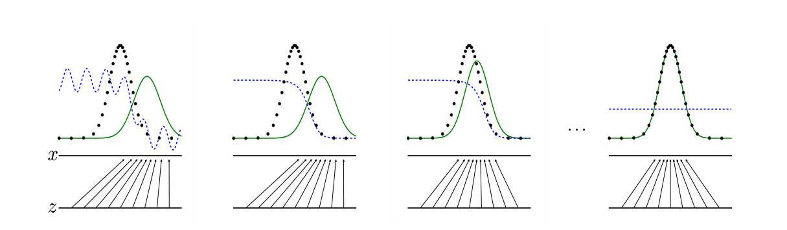

# Page 2 of 9 - Generative Adversarial Nets

> Page 2 of the source PDF, verbatim as extracted. Canonical document: [28 - Generative Adversarial Nets](../../papers/28-generative-adversarial-nets.md)

In other words, D and G play the following two-player minimax game with value function V (G, D):

D V (D, G) = Ex∼pdata(x)\[log D(x)\] + Ez∼pz(z)\[log(1 −D(G(z)))\]. (1)

min

G max

In the next section, we present a theoretical analysis of adversarial nets, essentially showing that the training criterion allows one to recover the data generating distribution as G and D are given enough capacity, i.e., in the non-parametric limit. See Figure 1 for a less formal, more pedagogical explanation of the approach. In practice, we must implement the game using an iterative, numerical approach. Optimizing D to completion in the inner loop of training is computationally prohibitive, and on finite datasets would result in overfitting. Instead, we alternate between k steps of optimizing D and one step of optimizing G. This results in D being maintained near its optimal solution, so long as G changes slowly enough. This strategy is analogous to the way that SML/PCD \[31, 29\] training maintains samples from a Markov chain from one learning step to the next in order to avoid burning in a Markov chain as part of the inner loop of learning. The procedure is formally presented in Algorithm 1.

In practice, equation 1 may not provide sufficient gradient for G to learn well. Early in learning, when G is poor, D can reject samples with high confidence because they are clearly different from the training data. In this case, log(1 −D(G(z))) saturates. Rather than training G to minimize log(1 −D(G(z))) we can train G to maximize log D(G(z)). This objective function results in the same fixed point of the dynamics of G and D but provides much stronger gradients early in learning.

...

x

z

(a) (b) (c) (d)

Figure 1: Generative adversarial nets are trained by simultaneously updating the discriminative distribution (D, blue, dashed line) so that it discriminates between samples from the data generating distribution (black, dotted line) px from those of the generative distribution pg (G) (green, solid line). The lower horizontal line is the domain from which z is sampled, in this case uniformly. The horizontal line above is part of the domain of x. The upward arrows show how the mapping x = G(z) imposes the non-uniform distribution pg on transformed samples. G contracts in regions of high density and expands in regions of low density of pg. (a) Consider an adversarial pair near convergence: pg is similar to pdata and D is a partially accurate classifier. (b) In the inner loop of the algorithm D is trained to discriminate samples from data, converging to D∗(x) =

pdata(x) pdata(x)+pg(x). (c) After an update to G, gradient of D has guided G(z) to flow to regions that are more likely to be classified as data. (d) After several steps of training, if G and D have enough capacity, they will reach a point at which both cannot improve because pg = pdata. The discriminator is unable to differentiate between the two distributions, i.e. D(x) = 1

2.

## 4 Theoretical Results

The generator G implicitly defines a probability distribution pg as the distribution of the samples G(z) obtained when z ∼pz. Therefore, we would like Algorithm 1 to converge to a good estimator of pdata, if given enough capacity and training time. The results of this section are done in a nonparametric setting, e.g. we represent a model with infinite capacity by studying convergence in the space of probability density functions.

We will show in section 4.1 that this minimax game has a global optimum for pg = pdata. We will then show in section 4.2 that Algorithm 1 optimizes Eq 1, thus obtaining the desired result.

---

[previous page](page-001.md) · [next page](page-003.md) · [all pages](index.md)
