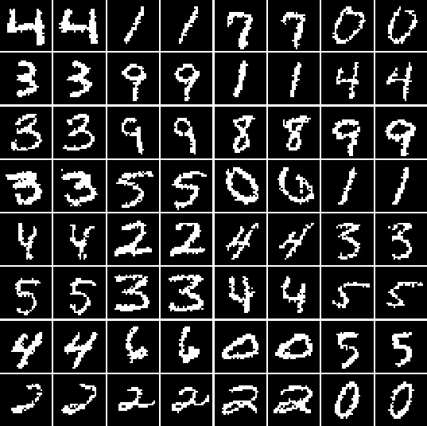
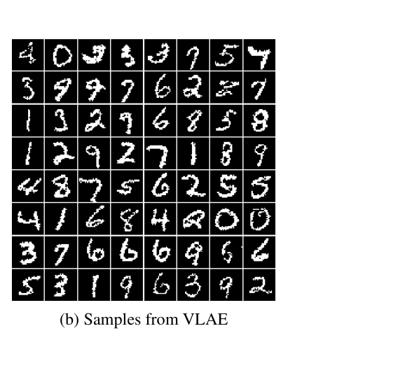
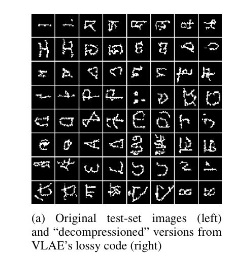
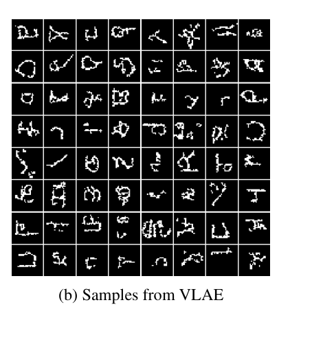

# Page 6 of 17 - Variational Lossy Autoencoder

> Page 6 of the source PDF, verbatim as extracted. Canonical document: [29 - Variational Lossy Autoencoder](../../papers/29-variational-lossy-autoencoder.md)

Published as a conference paper at ICLR 2017

(a) Original test-set images (left) and “decompressioned” versions from VLAE’s lossy code (right)

(b) Samples from VLAE

Figure 1: Statically Binarized MNIST

decompressions is an exact reconstruction of the original image but instead the global structure of the image was encoded in the lossy code z and regenerated. Also worth noting is that local statistics are not preserved but a new set of likely local statistics are generated in the decompressed images: the binary masks are usually different and local styles like stroke width are sometimes slightly different.

However, we remark that the lossy code z doesn’t always capture the kind of global information that we care about and it’s dependent on the type of constraint we put on the decoder. For instance, in Fig 4b, we show decompressions for OMNIGLOT dataset, which has more meaningful variations in small patches than MNIST, and we can observe that semantics are not preserved in some cases. This highlights the need to specify the type of statistics we care about in a representation, which will be different across tasks and datasets, and design decoding distribution accordingly.

(a) Original test-set images (left) and “decompressioned” versions from VLAE’s lossy code (right)

(b) Samples from VLAE

Figure 2: OMNIGLOT

4.2 DENSITY ESTIMATION

Next we investigate whether leveraging autoregressive models as latent distribution p(z) and as decoding distribution p(x|z) would improve density estimation performance.

To verify whether AF prior is able to improve upon IAF posterior alone, it’s desirable to test this model without using autoregressive decoder but instead using the conventional independent Bernoulli distribution for p(x|z). Hence we use the best performing model from Kingma et al.

7

---

[previous page](page-005.md) · [next page](page-007.md) · [all pages](index.md)
