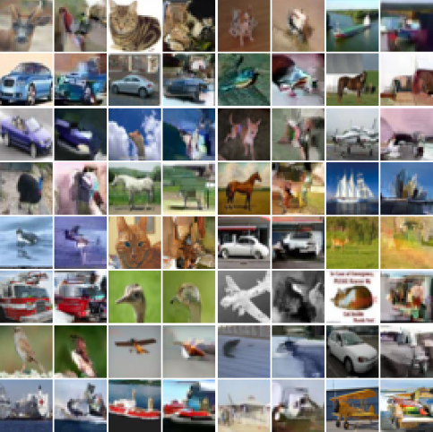
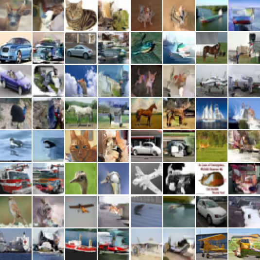
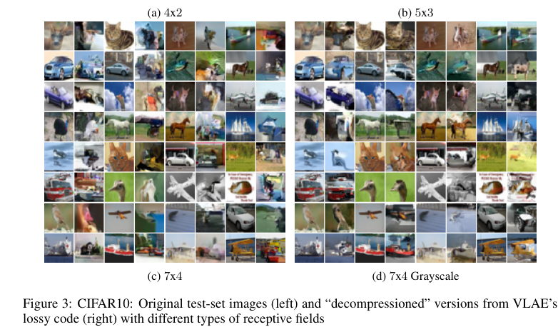
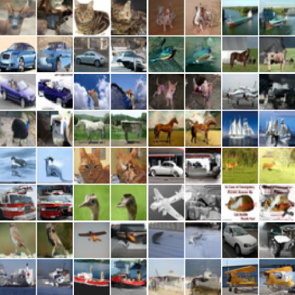

# Page 9 of 17 - Variational Lossy Autoencoder

> Page 9 of the source PDF, verbatim as extracted. Canonical document: [29 - Variational Lossy Autoencoder](../../papers/29-variational-lossy-autoencoder.md)

Published as a conference paper at ICLR 2017

(a) 4x2

(b) 5x3

(c) 7x4

(d) 7x4 Grayscale

Figure 3: CIFAR10: Original test-set images (left) and “decompressioned” versions from VLAE’s lossy code (right) with different types of receptive fields

It’s interesting to also note that in (a)-(c), oftentimes color information is partially omitted from latent codes and one explanation can be that color is very predictable locally. However, color information can be important to preserve if our task is, for example, object classification. To demonstrate how we can encode color information in the lossy code, we can choose to make PixelCNN decoder depend only on images’ grayscale versions. In other words, instead of choosing the decoder to be plocal(x|z) = Q

i p(xi|z, xWindowAround(i)), we use a decoder of the form plocal(x|z) = Q

i p(xi|z, Grayscale(xWindowAround(i))). In (d) of Figure 3, we visualize lossy codes for a VLAE that has the same receptive field size as (c) but uses a “grayscale receptive field”. We note that the lossy codes in (d) encode roughly the same structural information as those in (c) but generally generate objects that are more recognizable due to the preservation of color information. This serves as one example of how we can design the lossy latent code carefully to encode what’s important and what’s not.

## 5 RELATED WORK

We investigate a fusion between variational autoencoders with continuous latent variables (Kingma & Welling, 2013; Rezende et al., 2014) and neural autoregressive models. For autoregression, we specifically apply a novel type of architecture where autoregression is realised through a carefully

10

---

[previous page](page-008.md) · [next page](page-010.md) · [all pages](index.md)
