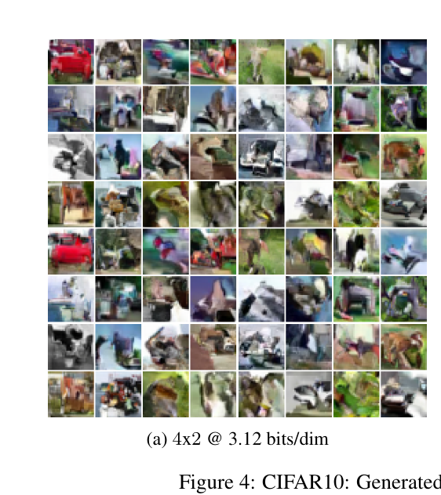
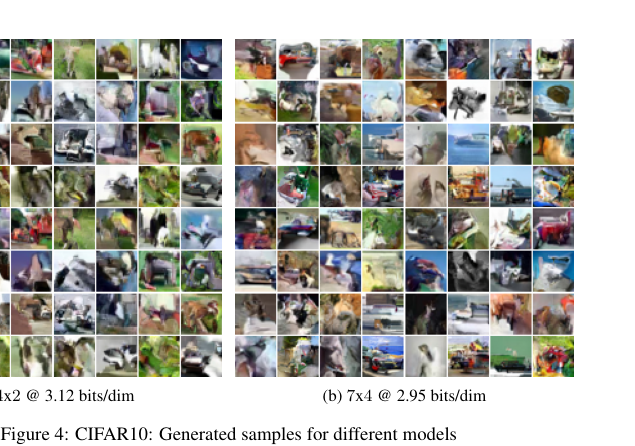

# Page 16 of 17 - Variational Lossy Autoencoder

> Page 16 of the source PDF, verbatim as extracted. Canonical document: [29 - Variational Lossy Autoencoder](../../papers/29-variational-lossy-autoencoder.md)

Published as a conference paper at ICLR 2017

(a) 4x2 @ 3.12 bits/dim

(b) 7x4 @ 2.95 bits/dim

Figure 4: CIFAR10: Generated samples for different models

Djork-Arn´e Clevert, Thomas Unterthiner, and Sepp Hochreiter. Fast and accurate deep network

learning by Exponential Linear Units (ELUs). arXiv preprint arXiv:1511.07289, 2015.

Mathieu Germain, Karol Gregor, Iain Murray, and Hugo Larochelle. Made: Masked autoencoder

for distribution estimation. arXiv preprint arXiv:1502.03509, 2015.

Kaiming He, Xiangyu Zhang, Shaoqing Ren, and Jian Sun. Deep residual learning for image recog-

nition. arXiv preprint arXiv:1512.03385, 2015.

Diederik Kingma and Jimmy Ba. Adam: A method for stochastic optimization. arXiv preprint

arXiv:1412.6980, 2014.

Diederik P Kingma, Tim Salimans, and Max Welling. Improving variational inference with inverse

autoregressive flow. arXiv preprint arXiv:1606.04934, 2016.

Vinod Nair and Geoffrey E Hinton. Rectified linear units improve restricted boltzmann machines. In

Proceedings of the 27th International Conference on Machine Learning (ICML-10), pp. 807–814, 2010.

Boris T Polyak and Anatoli B Juditsky. Acceleration of stochastic approximation by averaging.

SIAM Journal on Control and Optimization, 30(4):838–855, 1992.

Tim Salimans and Diederik P Kingma. Weight normalization: A simple reparameterization to ac-

celerate training of deep neural networks. arXiv preprint arXiv:1602.07868, 2016.

Tim Salimans, Andrej Karpathy, Xi Chen, and Diederik P Kingma. Pixelcnn++: Improving the

pixelcnn with discretized logistic mixture likelihood and other modifications. arXiv preprint arXiv:1701.05517, 2017.

Iulian Vlad Serban, Alessandro Sordoni, Ryan Lowe, Laurent Charlin, Joelle Pineau, Aaron

Courville, and Yoshua Bengio. A hierarchical latent variable encoder-decoder model for generating dialogues. arXiv preprint arXiv:1605.06069, 2016.

Aaron van den Oord, Nal Kalchbrenner, and Koray Kavukcuoglu. Pixel recurrent neural networks.

arXiv preprint arXiv:1601.06759, 2016a.

Aaron van den Oord, Nal Kalchbrenner, Oriol Vinyals, Lasse Espeholt, Alex Graves, and Ko-

ray Kavukcuoglu. Conditional image generation with pixelcnn decoders. arXiv preprint arXiv:1606.05328, 2016b.

17

---

[previous page](page-015.md) · [next page](page-017.md) · [all pages](index.md)
