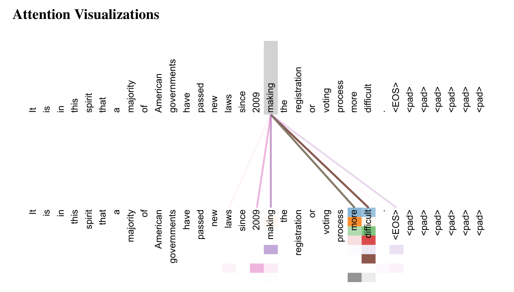
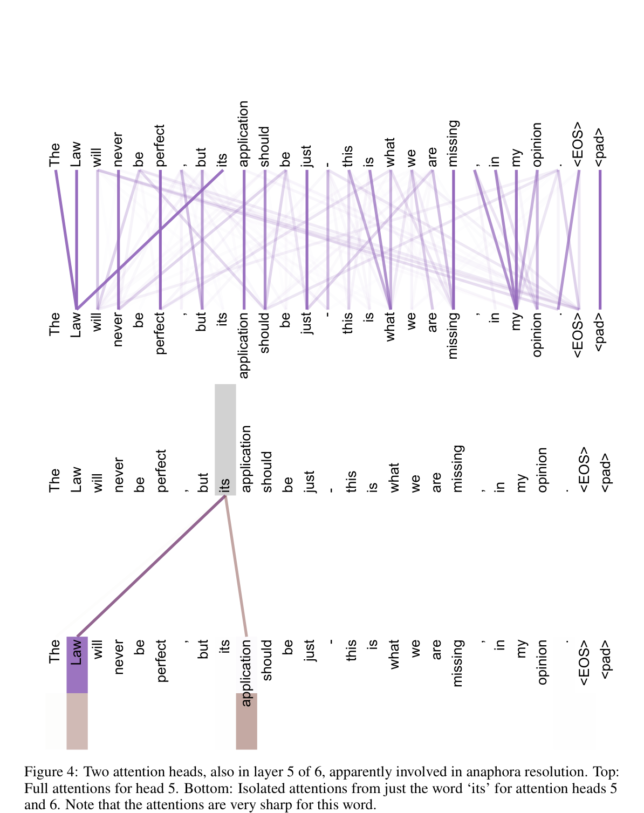
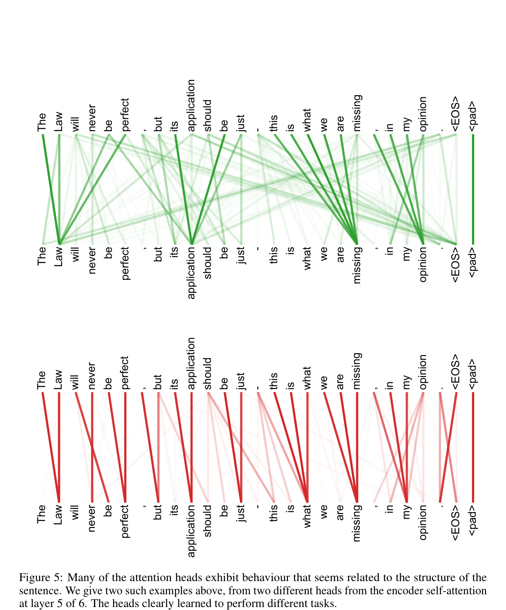

# Attention Visualizations

> Section 11 of 11 from [01 - Attention Is All You Need](../../papers/01-attention-is-all-you-need.md) · `other` · pages 12-15

governments

registration

American

majority

process

<EOS>

passed

making

difficult

<pad>

<pad>

<pad>

<pad>

<pad>

<pad>

voting

since

more

2009

have

spirit

laws

new

that

this

the

or

of

in

is

It

a

.

It

is

in

this

spirit

that

a

majority

of

American

governments

have

passed

new

laws

since

2009

making

the

registration

or

voting

process

more

difficult

.

<EOS>

<pad>

<pad>

<pad>

<pad>

<pad>

<pad>

Figure 3: An example of the attention mechanism following long-distance dependencies in the encoder self-attention in layer 5 of 6. Many of the attention heads attend to a distant dependency of the verb ‘making’, completing the phrase ‘making...more difficult’. Attentions here shown only for the word ‘making’. Different colors represent different heads. Best viewed in color.

application

missing

<EOS>

opinion

perfect

should

<pad>

never

what

Law

The

just

this

are

will

but

my

we

be

be

its

in

is

-

,

,

.

The

Law

will

never

be

perfect

,

but

its

application

should

be

just

-

this

is

what

we

are

missing

,

in

my

opinion

.

<EOS>

<pad>

application

missing

<EOS>

opinion

perfect

should

<pad>

never

what

Law

The

just

this

are

will

but

my

we

be

be

its

in

is

-

,

,

.

The

Law

will

never

be

perfect

,

but

its

application

should

be

just

-

this

is

what

we

are

missing

,

in

my

opinion

.

<EOS>

<pad>

Figure 4: Two attention heads, also in layer 5 of 6, apparently involved in anaphora resolution. Top: Full attentions for head 5. Bottom: Isolated attentions from just the word ‘its’ for attention heads 5 and 6. Note that the attentions are very sharp for this word.

application

missing

<EOS>

opinion

perfect

should

<pad>

never

what

Law

The

just

this

are

will

but

my

we

be

be

its

in

is

-

,

,

.

The

Law

will

never

be

perfect

,

but

its

application

should

be

just

-

this

is

what

we

are

missing

,

in

my

opinion

.

<EOS>

<pad>

application

missing

<EOS>

opinion

perfect

should

<pad>

never

what

Law

The

just

this

are

will

but

my

we

be

be

its

in

is

-

,

,

.

The

Law

will

never

be

perfect

,

but

its

application

should

be

just

-

this

is

what

we

are

missing

,

in

my

opinion

.

<EOS>

<pad>

Figure 5: Many of the attention heads exhibit behaviour that seems related to the structure of the sentence. We give two such examples above, from two different heads from the encoder self-attention at layer 5 of 6. The heads clearly learned to perform different tasks.

---

Full document: [01 - Attention Is All You Need](../../papers/01-attention-is-all-you-need.md) · Page-level evidence: [paper-pages/01-attention-is-all-you-need](../../paper-pages/01-attention-is-all-you-need/index.md)
