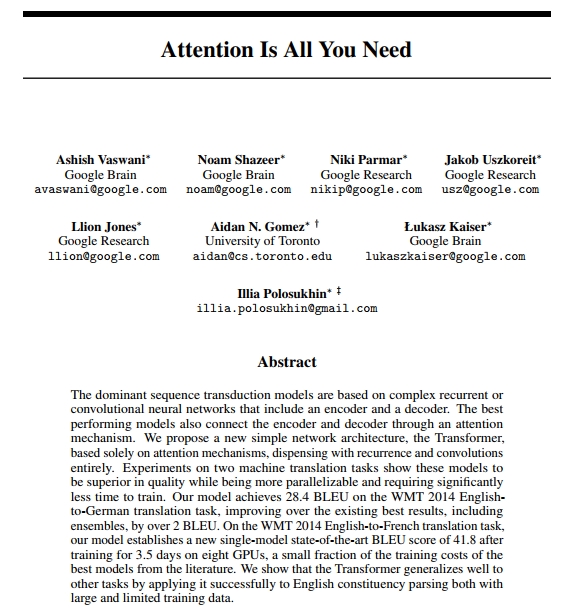

# Front matter

> Section 1 of 28 from [02 - The Annotated Transformer](../../papers/02-the-annotated-transformer.md) · `front-matter` · pages n/a

The text below was extracted from the published source (web article) on 2026-11-17. The published HTML article, converted to markdown. Code listings and LaTeX source blocks are kept as they appear on the page.

```python
from IPython.display import Image
Image(filename='images/aiayn.png')
```



The Transformer from [“Attention is All You\\
Need”](https://arxiv.org/abs/1706.03762) has been on a lot of people’s minds
over the last year. Besides producing major improvements in translation quality,
it provides a new architecture for many other NLP tasks. The paper itself is
very clearly written, but the conventional wisdom has been that it is quite
difficult to implement correctly.

In this post I present an “annotated” version of the paper in the form of a
line-by-line implementation. I have reordered and deleted some sections from the
original paper and added comments throughout. This document itself is a working
notebook, and should be a completely usable implementation. In total there are
400 lines of library code which can process 27,000 tokens per second on 4 GPUs.

To follow along you will first need to install
[PyTorch](http://pytorch.org/). The complete notebook is also
available on
[github](https://github.com/harvardnlp/annotated-transformer) or on
Google
[Colab](https://drive.google.com/file/d/1xQXSv6mtAOLXxEMi8RvaW8TW-7bvYBDF/view?usp=sharing) with free GPUs.

Note this is merely a starting point for researchers and interested developers.
The code here is based heavily on our [OpenNMT](http://opennmt.net/) packages.
(If helpful feel free to [cite](https://nlp.seas.harvard.edu/2018/04/03/attention.html#conclusion).) For other full-sevice
implementations of the model check-out
[Tensor2Tensor](https://github.com/tensorflow/tensor2tensor) (tensorflow) and
[Sockeye](https://github.com/awslabs/sockeye) (mxnet).

- Alexander Rush ( [@harvardnlp](https://twitter.com/harvardnlp) or
srush@seas.harvard.edu), with help from Vincent Nguyen and Guillaume Klein

---

Full document: [02 - The Annotated Transformer](../../papers/02-the-annotated-transformer.md) · Page-level evidence: [paper-pages/02-the-annotated-transformer](../../paper-pages/02-the-annotated-transformer/index.md)
