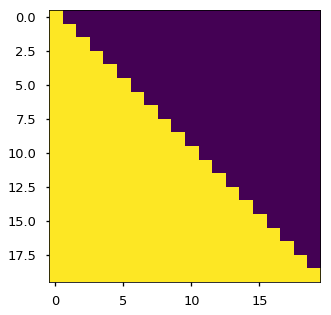

# Decoder

> Section 6 of 28 from [02 - The Annotated Transformer](../../papers/02-the-annotated-transformer.md) · `other` · pages n/a

The decoder is also composed of a stack of N=6N=6 identical layers.

```python
class Decoder(nn.Module):
    "Generic N layer decoder with masking."
    def __init__(self, layer, N):
        super(Decoder, self).__init__()
        self.layers = clones(layer, N)
        self.norm = LayerNorm(layer.size)

    def forward(self, x, memory, src_mask, tgt_mask):
        for layer in self.layers:
            x = layer(x, memory, src_mask, tgt_mask)
        return self.norm(x)
```

In addition to the two sub-layers in each encoder layer, the decoder inserts a
third sub-layer, which performs multi-head attention over the output of the
encoder stack. Similar to the encoder, we employ residual connections around
each of the sub-layers, followed by layer normalization.

```python
class DecoderLayer(nn.Module):
    "Decoder is made of self-attn, src-attn, and feed forward (defined below)"
    def __init__(self, size, self_attn, src_attn, feed_forward, dropout):
        super(DecoderLayer, self).__init__()
        self.size = size
        self.self_attn = self_attn
        self.src_attn = src_attn
        self.feed_forward = feed_forward
        self.sublayer = clones(SublayerConnection(size, dropout), 3)

    def forward(self, x, memory, src_mask, tgt_mask):
        "Follow Figure 1 (right) for connections."
        m = memory
        x = self.sublayer[0](x, lambda x: self.self_attn(x, x, x, tgt_mask))
        x = self.sublayer[1](x, lambda x: self.src_attn(x, m, m, src_mask))
        return self.sublayer[2](x, self.feed_forward)
```

We also modify the self-attention sub-layer in the decoder stack to prevent
positions from attending to subsequent positions. This masking, combined with
fact that the output embeddings are offset by one position, ensures that the
predictions for position ii can depend only on the known outputs at positions
less than ii.

```python
def subsequent_mask(size):
    "Mask out subsequent positions."
    attn_shape = (1, size, size)
    subsequent_mask = np.triu(np.ones(attn_shape), k=1).astype('uint8')
    return torch.from_numpy(subsequent_mask) == 0
```

> Below the attention mask shows the position each tgt word (row) is allowed to
> look at (column). Words are blocked for attending to future words during
> training.

```python
plt.figure(figsize=(5,5))
plt.imshow(subsequent_mask(20)[0])
None
```



---

Full document: [02 - The Annotated Transformer](../../papers/02-the-annotated-transformer.md) · Page-level evidence: [paper-pages/02-the-annotated-transformer](../../paper-pages/02-the-annotated-transformer/index.md)
