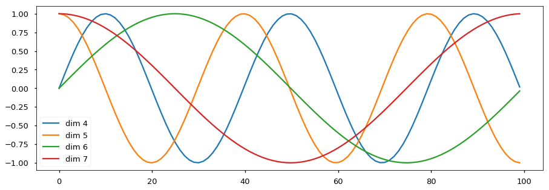

# Positional Encoding

> Section 9 of 28 from [02 - The Annotated Transformer](../../papers/02-the-annotated-transformer.md) · `other` · pages n/a

Since our model contains no recurrence and no convolution, in order for the
model to make use of the order of the sequence, we must inject some information
about the relative or absolute position of the tokens in the sequence. To this
end, we add “positional encodings” to the input embeddings at the bottoms of the
encoder and decoder stacks. The positional encodings have the same dimension
dmodeldmodel as the embeddings, so that the two can be summed. There are
many choices of positional encodings, learned and fixed
[(cite)](https://arxiv.org/pdf/1705.03122.pdf).

In this work, we use sine and cosine functions of different frequencies:
PE(pos,2i)=sin(pos/100002i/dmodel)PE(pos,2i)=sin(pos/100002i/dmodel)

PE(pos,2i+1)=cos(pos/100002i/dmodel)PE(pos,2i+1)=cos(pos/100002i/dmodel)
where pospos is the position and ii is the dimension. That is, each dimension
of the positional encoding corresponds to a sinusoid. The wavelengths form a
geometric progression from 2π2π to 10000⋅2π10000⋅2π. We chose this function
because we hypothesized it would allow the model to easily learn to attend by
relative positions, since for any fixed offset kk, PEpos+kPEpos+k can be
represented as a linear function of PEposPEpos.

In addition, we apply dropout to the sums of the embeddings and the positional
encodings in both the encoder and decoder stacks. For the base model, we use a
rate of Pdrop=0.1Pdrop=0.1.

```python
class PositionalEncoding(nn.Module):
    "Implement the PE function."
    def __init__(self, d_model, dropout, max_len=5000):
        super(PositionalEncoding, self).__init__()
        self.dropout = nn.Dropout(p=dropout)

        # Compute the positional encodings once in log space.
        pe = torch.zeros(max_len, d_model)
        position = torch.arange(0, max_len).unsqueeze(1)
        div_term = torch.exp(torch.arange(0, d_model, 2) *
                             -(math.log(10000.0) / d_model))
        pe[:, 0::2] = torch.sin(position * div_term)
        pe[:, 1::2] = torch.cos(position * div_term)
        pe = pe.unsqueeze(0)
        self.register_buffer('pe', pe)

    def forward(self, x):
        x = x + Variable(self.pe[:, :x.size(1)],
                         requires_grad=False)
        return self.dropout(x)
```

> Below the positional encoding will add in a sine wave based on position. The
> frequency and offset of the wave is different for each dimension.

```python
plt.figure(figsize=(15, 5))
pe = PositionalEncoding(20, 0)
y = pe.forward(Variable(torch.zeros(1, 100, 20)))
plt.plot(np.arange(100), y[0, :, 4:8].data.numpy())
plt.legend(["dim %d"%p for p in [4,5,6,7]])
None
```



We also experimented with using learned positional embeddings
[(cite)](https://arxiv.org/pdf/1705.03122.pdf) instead, and found that the two
versions produced nearly identical results. We chose the sinusoidal version
because it may allow the model to extrapolate to sequence lengths longer than
the ones encountered during training.

---

Full document: [02 - The Annotated Transformer](../../papers/02-the-annotated-transformer.md) · Page-level evidence: [paper-pages/02-the-annotated-transformer](../../paper-pages/02-the-annotated-transformer/index.md)
