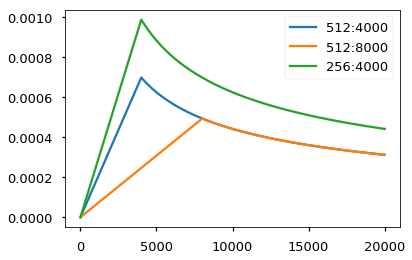

# Optimizer

> Section 14 of 28 from [02 - The Annotated Transformer](../../papers/02-the-annotated-transformer.md) · `other` · pages n/a

We used the Adam optimizer [(cite)](https://arxiv.org/abs/1412.6980) with
β1=0.9β1=0.9, β2=0.98β2=0.98 and ϵ=10−9ϵ=10−9. We varied the learning
rate over the course of training, according to the formula:
lrate=d−0.5model⋅min(step\_num−0.5,step\_num⋅warmup\_steps−1.5)lrate=dmodel−0.5⋅min(step\_num−0.5,step\_num⋅warmup\_steps−1.5)
This corresponds to increasing the learning rate linearly for the first
warmupstepswarmupsteps training steps, and decreasing it thereafter proportionally to
the inverse square root of the step number. We used warmupsteps=4000warmupsteps=4000.

> Note: This part is very important. Need to train with this setup of the model.

```python
class NoamOpt:
    "Optim wrapper that implements rate."
    def __init__(self, model_size, factor, warmup, optimizer):
        self.optimizer = optimizer
        self._step = 0
        self.warmup = warmup
        self.factor = factor
        self.model_size = model_size
        self._rate = 0

    def step(self):
        "Update parameters and rate"
        self._step += 1
        rate = self.rate()
        for p in self.optimizer.param_groups:
            p['lr'] = rate
        self._rate = rate
        self.optimizer.step()

    def rate(self, step = None):
        "Implement `lrate` above"
        if step is None:
            step = self._step
        return self.factor * \
            (self.model_size ** (-0.5) *
            min(step ** (-0.5), step * self.warmup ** (-1.5)))

def get_std_opt(model):
    return NoamOpt(model.src_embed[0].d_model, 2, 4000,
            torch.optim.Adam(model.parameters(), lr=0, betas=(0.9, 0.98), eps=1e-9))
```

> Example of the curves of this model for different model sizes and for
> optimization hyperparameters.

```python
## Three settings of the lrate hyperparameters.
opts = [NoamOpt(512, 1, 4000, None),\
        NoamOpt(512, 1, 8000, None),\
        NoamOpt(256, 1, 4000, None)]
plt.plot(np.arange(1, 20000), [[opt.rate(i) for opt in opts] for i in range(1, 20000)])
plt.legend(["512:4000", "512:8000", "256:4000"])
None
```



---

Full document: [02 - The Annotated Transformer](../../papers/02-the-annotated-transformer.md) · Page-level evidence: [paper-pages/02-the-annotated-transformer](../../paper-pages/02-the-annotated-transformer/index.md)
