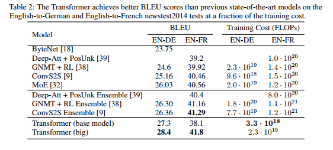

# Results

> Section 26 of 28 from [02 - The Annotated Transformer](../../papers/02-the-annotated-transformer.md) · `results` · pages n/a

On the WMT 2014 English-to-German translation task, the big transformer model
(Transformer (big)
in Table 2) outperforms the best previously reported models (including
ensembles) by more than 2.0
BLEU, establishing a new state-of-the-art BLEU score of 28.4. The configuration
of this model is
listed in the bottom line of Table 3. Training took 3.5 days on 8 P100 GPUs.
Even our base model
surpasses all previously published models and ensembles, at a fraction of the
training cost of any of
the competitive models.

On the WMT 2014 English-to-French translation task, our big model achieves a
BLEU score of 41.0,
outperforming all of the previously published single models, at less than 1/4
the training cost of the
previous state-of-the-art model. The Transformer (big) model trained for
English-to-French used
dropout rate Pdrop = 0.1, instead of 0.3.

```python
Image(filename="images/results.png")
```



> The code we have written here is a version of the base model. There are fully
> trained version of this system available here [(Example\\
> Models)](http://opennmt.net/Models-py/).
>
> With the addtional extensions in the last section, the OpenNMT-py replication
> gets to 26.9 on EN-DE WMT. Here I have loaded in those parameters to our
> reimplemenation.

```python
!wget https://s3.amazonaws.com/opennmt-models/en-de-model.pt
```

```python
model, SRC, TGT = torch.load("en-de-model.pt")
```

```python
model.eval()
sent = "▁The ▁log ▁file ▁can ▁be ▁sent ▁secret ly ▁with ▁email ▁or ▁FTP ▁to ▁a ▁specified ▁receiver".split()
src = torch.LongTensor([[SRC.stoi[w] for w in sent]])
src = Variable(src)
src_mask = (src != SRC.stoi["<blank>"]).unsqueeze(-2)
out = greedy_decode(model, src, src_mask,
                    max_len=60, start_symbol=TGT.stoi["<s>"])
print("Translation:", end="\t")
trans = "<s> "
for i in range(1, out.size(1)):
    sym = TGT.itos[out[0, i]]
    if sym == "</s>": break
    trans += sym + " "
print(trans)
```

```
Translation:	<s> ▁Die ▁Protokoll datei ▁kann ▁ heimlich ▁per ▁E - Mail ▁oder ▁FTP ▁an ▁einen ▁bestimmte n ▁Empfänger ▁gesendet ▁werden .
```

---

Full document: [02 - The Annotated Transformer](../../papers/02-the-annotated-transformer.md) · Page-level evidence: [paper-pages/02-the-annotated-transformer](../../paper-pages/02-the-annotated-transformer/index.md)
