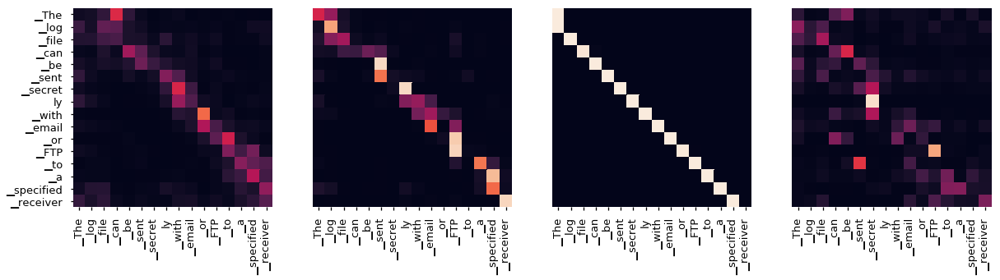
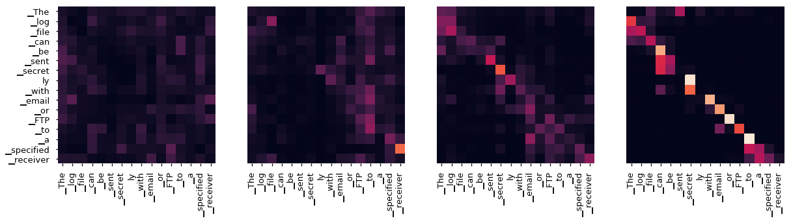
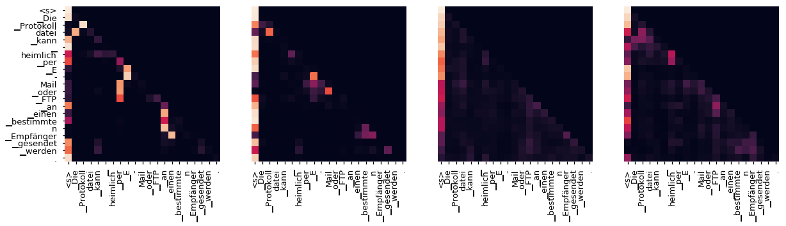
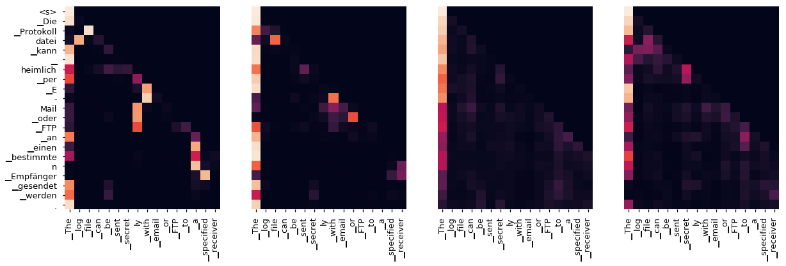
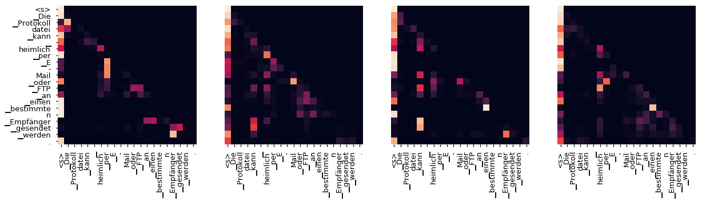
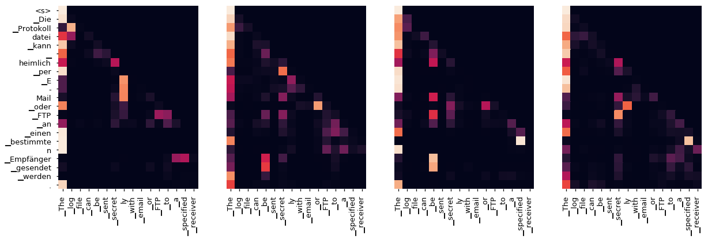
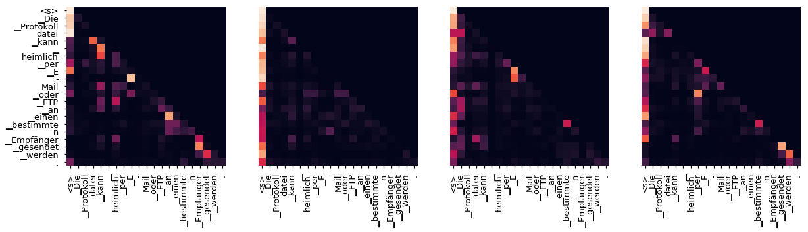
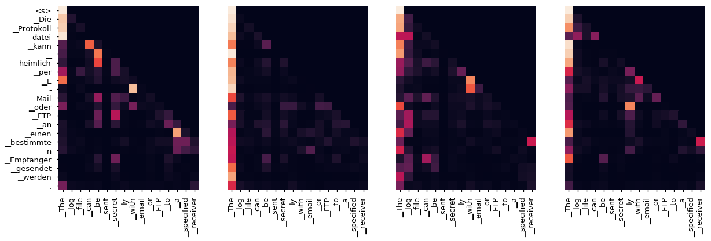

# Attention Visualization

> Section 27 of 28 from [02 - The Annotated Transformer](../../papers/02-the-annotated-transformer.md) · `other` · pages n/a

> Even with a greedy decoder the translation looks pretty good. We can further
> visualize it to see what is happening at each layer of the attention

```python
tgt_sent = trans.split()
def draw(data, x, y, ax):
    seaborn.heatmap(data,
                    xticklabels=x, square=True, yticklabels=y, vmin=0.0, vmax=1.0,
                    cbar=False, ax=ax)

for layer in range(1, 6, 2):
    fig, axs = plt.subplots(1,4, figsize=(20, 10))
    print("Encoder Layer", layer+1)
    for h in range(4):
        draw(model.encoder.layers[layer].self_attn.attn[0, h].data,
            sent, sent if h ==0 else [], ax=axs[h])
    plt.show()

for layer in range(1, 6, 2):
    fig, axs = plt.subplots(1,4, figsize=(20, 10))
    print("Decoder Self Layer", layer+1)
    for h in range(4):
        draw(model.decoder.layers[layer].self_attn.attn[0, h].data[:len(tgt_sent), :len(tgt_sent)],
            tgt_sent, tgt_sent if h ==0 else [], ax=axs[h])
    plt.show()
    print("Decoder Src Layer", layer+1)
    fig, axs = plt.subplots(1,4, figsize=(20, 10))
    for h in range(4):
        draw(model.decoder.layers[layer].self_attn.attn[0, h].data[:len(tgt_sent), :len(sent)],
            sent, tgt_sent if h ==0 else [], ax=axs[h])
    plt.show()
```

```
Encoder Layer 2
```



```
Encoder Layer 4
```



```
Encoder Layer 6
```


```
Decoder Self Layer 2
```



```
Decoder Src Layer 2
```



```
Decoder Self Layer 4
```



```
Decoder Src Layer 4
```



```
Decoder Self Layer 6
```



```
Decoder Src Layer 6
```



---

Full document: [02 - The Annotated Transformer](../../papers/02-the-annotated-transformer.md) · Page-level evidence: [paper-pages/02-the-annotated-transformer](../../paper-pages/02-the-annotated-transformer/index.md)
