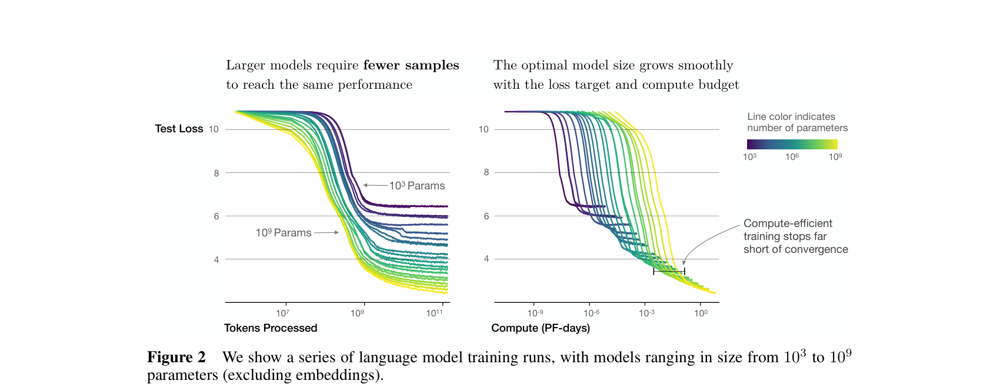

# 1.1 Summary

> Section 4 of 45 from [03 - Scaling Laws for Neural Language Models](../../papers/03-scaling-laws-for-neural-language-models.md) · `other` · pages 1-3

Our key findings for Transformer language models are are as follows:

2Here we display predicted compute when using a sufficiently small batch size. See Figure 13 for comparison to the purely empirical data.

Test Loss

Parameters non-embedding Compute PF-days, non-embedding

Dataset Size

tokens

Figure 1 Language modeling performance improves smoothly as we increase the model size, datasetset size, and amount of compute2 used for training. For optimal performance all three factors must be scaled up in tandem. Empirical performance has a power-law relationship with each individual factor when not bottlenecked by the other two.

Performance depends strongly on scale, weakly on model shape: Model performance depends most strongly on scale, which consists of three factors: the number of model parameters N (excluding embeddings), the size of the dataset D, and the amount of compute C used for training. Within reasonable limits, performance depends very weakly on other architectural hyperparameters such as depth vs. width. (Section 3)

Smooth power laws: Performance has a power-law relationship with each of the three scale factors N, D, C when not bottlenecked by the other two, with trends spanning more than six orders of magnitude (see Figure 1). We observe no signs of deviation from these trends on the upper end, though performance must flatten out eventually before reaching zero loss. (Section 3)

Universality of overfitting: Performance improves predictably as long as we scale up N and D in tandem, but enters a regime of diminishing returns if either N or D is held fixed while the other increases. The performance penalty depends predictably on the ratio N 0.74/D, meaning that every time we increase the model size 8x, we only need to increase the data by roughly 5x to avoid a penalty. (Section 4)

Universality of training: Training curves follow predictable power-laws whose parameters are roughly independent of the model size. By extrapolating the early part of a training curve, we can roughly predict the loss that would be achieved if we trained for much longer. (Section 5)

Transfer improves with test performance: When we evaluate models on text with a different distribution than they were trained on, the results are strongly correlated to those on the training validation set with a roughly constant offset in the loss – in other words, transfer to a different distribution incurs a constant penalty but otherwise improves roughly in line with performance on the training set. (Section 3.2.2)

Sample efficiency: Large models are more sample-efficient than small models, reaching the same level of performance with fewer optimization steps (Figure 2) and using fewer data points (Figure 4).

Convergence is inefficient: When working within a fixed compute budget C but without any other restrictions on the model size N or available data D, we attain optimal performance by training very large models and stopping significantly short of convergence (see Figure 3). Maximally compute-efficient training would therefore be far more sample efficient than one might expect based on training small models to convergence, with data requirements growing very slowly as D ∼C0.27 with training compute. (Section 6)

Optimal batch size: The ideal batch size for training these models is roughly a power of the loss only, and continues to be determinable by measuring the gradient noise scale \[MKAT18\]; it is roughly 1-2 million tokens at convergence for the largest models we can train. (Section 5.1)

Taken together, these results show that language modeling performance improves smoothly and predictably as we appropriately scale up model size, data, and compute. We expect that larger language models will perform better and be more sample efficient than current models.

Larger models require fewer samples to reach the same performance

The optimal model size grows smoothly with the loss target and compute budget

Line color indicates number of parameters

Test Loss

10

10

103 109 106

8

8

103 Params

6

6

Compute-efficient training stops far short of convergence

109 Params

4

4

107 109 1011

10-9 10-6 10-3 100

Tokens Processed Compute (PF-days)

Figure 2 We show a series of language model training runs, with models ranging in size from 103 to 109 parameters (excluding embeddings).

<10x Serial Steps

Minimum serial steps increases negligibly

Data requirements grow relatively slowly

100x Batch Size

Optimal model size increases very quickly

>1,000,000x Model Size

Figure 3 As more compute becomes available, we can choose how much to allocate towards training larger models, using larger batches, and training for more steps. We illustrate this for a billion-fold increase in compute. For optimally compute-efficient training, most of the increase should go towards increased model size. A relatively small increase in data is needed to avoid reuse. Of the increase in data, most can be used to increase parallelism through larger batch sizes, with only a very small increase in serial training time required.

---

Full document: [03 - Scaling Laws for Neural Language Models](../../papers/03-scaling-laws-for-neural-language-models.md) · Page-level evidence: [paper-pages/03-scaling-laws-for-neural-language-models](../../paper-pages/03-scaling-laws-for-neural-language-models/index.md)
