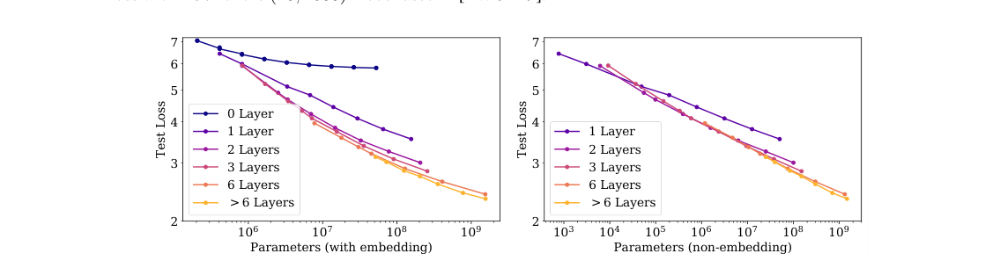

# 3 Empirical Results and Basic Power Laws

> Section 12 of 45 from [03 - Scaling Laws for Neural Language Models](../../papers/03-scaling-laws-for-neural-language-models.md) · `other` · pages 6-7

To characterize language model scaling we train a wide variety of models, varying a number of factors including:

• Model size (ranging in size from 768 to 1.5 billion non-embedding parameters)

• Dataset size (ranging from 22 million to 23 billion tokens)

• Shape (including depth, width, attention heads, and feed-forward dimension)

• Context length (1024 for most runs, though we also experiment with shorter contexts)

• Batch size (219 for most runs, but we also vary it to measure the critical batch size)

10%

8%

Loss Increase

A wide range of architectures

6%

achieve similar performance

22% additional compute compensates for 1% loss increase

4%

2%

0%

Feed-Forward Ratio (dff / dmodel)

50M Parameters Aspect Ratio (dmodel / nlayer) Attention Head Dimension (dmodel / nhead)

25M Parameters

Figure 5 Performance depends very mildly on model shape when the total number of non-embedding parameters N is held fixed. The loss varies only a few percent over a wide range of shapes. Small differences in parameter counts are compensated for by using the fit to L(N) as a baseline. Aspect ratio in particular can vary by a factor of 40 while only slightly impacting performance; an (nlayer, dmodel) = (6, 4288) reaches a loss within 3% of the (48, 1600) model used in \[RWC+19\].

7

7

6

6

5

5

Test Loss

Test Loss

0 Layer 1 Layer 2 Layers 3 Layers 6 Layers > 6 Layers

4

4

1 Layer 2 Layers 3 Layers 6 Layers > 6 Layers

3

3

2

2

106 107 108 109

103 104 105 106 107 108 109

Parameters (with embedding)

Parameters (non-embedding)

Figure 6 Left: When we include embedding parameters, performance appears to depend strongly on the number of layers in addition to the number of parameters. Right: When we exclude embedding parameters, the performance of models with different depths converge to a single trend. Only models with fewer than 2 layers or with extreme depth-to-width ratios deviate significantly from the trend.

In this section we will display data along with empirically-motivated fits, deferring theoretical analysis to later sections.

---

Full document: [03 - Scaling Laws for Neural Language Models](../../papers/03-scaling-laws-for-neural-language-models.md) · Page-level evidence: [paper-pages/03-scaling-laws-for-neural-language-models](../../paper-pages/03-scaling-laws-for-neural-language-models/index.md)
