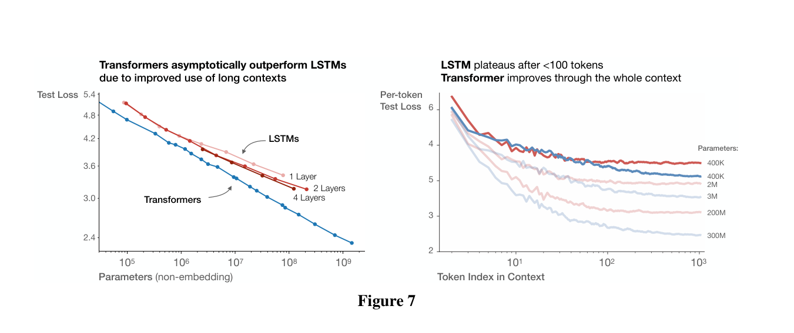

# 3.1 Approximate Transformer Shape and Hyperparameter Independence

> Section 13 of 45 from [03 - Scaling Laws for Neural Language Models](../../papers/03-scaling-laws-for-neural-language-models.md) · `other` · pages 7-8

Transformer performance depends very weakly on the shape parameters nlayer, nheads, and dffwhen we hold the total non-embedding parameter count N fixed. To establish these results we trained models with fixed size while varying a single hyperparameter. This was simplest for the case of nheads. When varying nlayer, we simultaneously varied dmodel while keeping N ≈12nlayerd2

model fixed. Similarly, to vary dffat fixed model size we also simultaneously varied the dmodel parameter, as required by the parameter counts in Table 1. Independence of nlayers would follow if deeper Transformers effectively behave as ensembles of shallower models, as has been suggested for ResNets \[VWB16\]. The results are shown in Figure 5.

3.2 Performance with Non-Embedding Parameter Count N

In Figure 6 we display the performance of a wide variety of models, ranging from small models with shape (nlayer, dmodel) = (2, 128) through billion-parameter models, ranging in shape from (6, 4288) through (207, 768). Here we have trained to near convergence on the full WebText2 dataset and observe no overfitting (except possibly for the very largest models).

As shown in Figure 1, we find a steady trend with non-embedding parameter count N, which can be fit to the first term of Equation (1.5), so that

αN

Nc

L(N) ≈

(3.1)

N

Transformers asymptotically outperform LSTMs due to improved use of long contexts

LSTM plateaus after <100 tokens Transformer improves through the whole context

Test Loss Per-token Test Loss

5.4

6

4.8

LSTMs

4.2

4

Parameters:

400K

3.6

1 Layer 2 Layers 4 Layers

400K

5

2M

3M

3.0

Transformers

200M

3

300M

2.4

2

105 108 106 107 109

103 102 101

Parameters (non-embedding)

Token Index in Context

Figure 7

To observe these trends it is crucial to study performance as a function of N; if we instead use the total parameter count (including the embedding parameters) the trend is somewhat obscured (see Figure 6). This suggests that the embedding matrix can be made smaller without impacting performance, as has been seen in recent work \[LCG+19\].

Although these models have been trained on the WebText2 dataset, their test loss on a variety of other datasets is also a power-law in N with nearly identical power, as shown in Figure 8.

---

Full document: [03 - Scaling Laws for Neural Language Models](../../papers/03-scaling-laws-for-neural-language-models.md) · Page-level evidence: [paper-pages/03-scaling-laws-for-neural-language-models](../../paper-pages/03-scaling-laws-for-neural-language-models/index.md)
