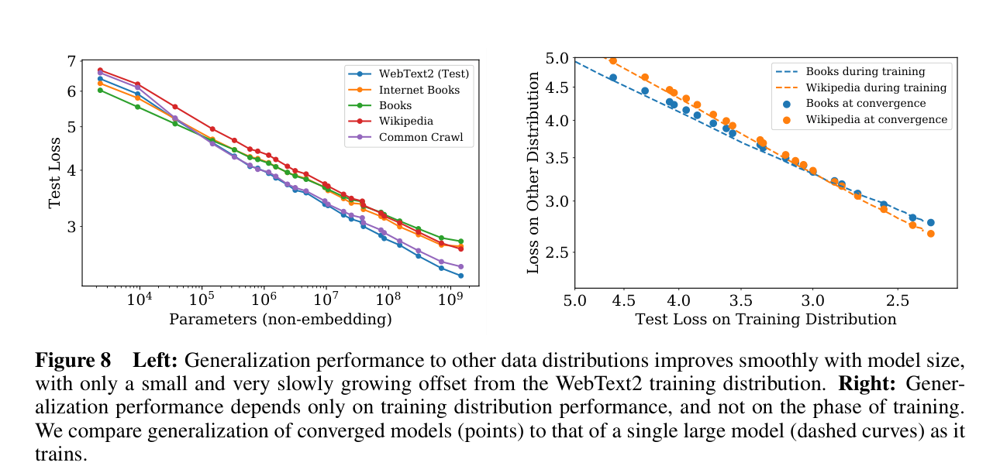

# 3.3 Performance with Dataset Size and Compute

> Section 16 of 45 from [03 - Scaling Laws for Neural Language Models](../../papers/03-scaling-laws-for-neural-language-models.md) · `other` · pages 8-9

We display empirical trends for the test loss as a function of dataset size D (in tokens) and training compute C in Figure 1.

For the trend with D we trained a model with (nlayer, nembd) = (36, 1280) on fixed subsets of the WebText2 dataset. We stopped training once the test loss ceased to decrease. We see that the resulting test losses can be fit with simple power-law

αD

Dc

L(D) ≈

(3.2)

D

in the dataset size. The data and fit appear in Figure 1.

The total amount of non-embedding compute used during training can be estimated as C = 6NBS, where B is the batch size, S is the number of parameter updates, and the factor of 6 accounts for the forward and backward passes. Thus for a given value of C we can scan over all models with various N to find the model

5.0

7

Books during training Wikipedia during training Books at convergence Wikipedia at convergence

WebText2 (Test) Internet Books Books Wikipedia Common Crawl

Loss on Other Distribution

4.5

6

4.0

5

Test Loss

3.5

4

3.0

3

2.5

104 105 106 107 108 109

2.5 3.0 3.5 4.0 4.5 5.0 Test Loss on Training Distribution

Parameters (non-embedding)

Figure 8 Left: Generalization performance to other data distributions improves smoothly with model size, with only a small and very slowly growing offset from the WebText2 training distribution. Right: Generalization performance depends only on training distribution performance, and not on the phase of training. We compare generalization of converged models (points) to that of a single large model (dashed curves) as it trains.

with the best performance on step S = C 6BS . Note that in these results the batch size B remains fixed for all models, which means that these empirical results are not truly optimal. We will account for this in later sections using an adjusted Cmin to produce cleaner trends.

The result appears as the heavy black line on the left-hand plot in Figure 1. It can be fit with

αC

Cc

L(C) ≈

(3.3)

C

The figure also includes images of individual learning curves to clarify when individual models are optimal. We will study the optimal allocation of compute more closely later on. The data strongly suggests that sample efficiency improves with model size, and we also illustrate this directly in Figure 19 in the appendix.

---

Full document: [03 - Scaling Laws for Neural Language Models](../../papers/03-scaling-laws-for-neural-language-models.md) · Page-level evidence: [paper-pages/03-scaling-laws-for-neural-language-models](../../paper-pages/03-scaling-laws-for-neural-language-models/index.md)
