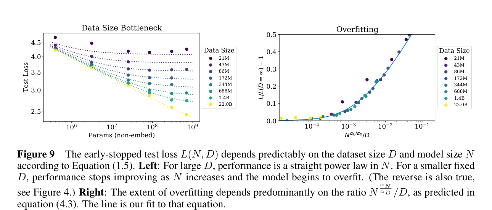

# 4 Charting the Infinite Data Limit and Overfitting

> Section 17 of 45 from [03 - Scaling Laws for Neural Language Models](../../papers/03-scaling-laws-for-neural-language-models.md) · `other` · pages 9-10

In Section 3 we found a number of basic scaling laws for language modeling performance. Here we will study the performance of a model of size N trained on a dataset with D tokens while varying N and D simultaneously. We will empirically demonstrate that the optimally trained test loss accords with the scaling law of Equation (1.5). This provides guidance on how much data we would need to train models of increasing size while keeping overfitting under control.

4.1 Proposed L(N, D) Equation

We have chosen the parameterization (1.5) (repeated here for convenience):

#αD

 αN

"Nc

αD + Dc

L(N, D) =

(4.1)

N

D

using three principles:

1. Changes in vocabulary size or tokenization are expected to rescale the loss by an overall factor. The parameterization of L(N, D) (and all models of the loss) must naturally allow for such a rescaling.

2. Fixing D and sending N →∞, the overall loss should approach L(D). Conversely, fixing N and sending D →∞the loss must approach L(N).

3. L(N, D) should be analytic at D = ∞, so that it has a series expansion in 1/D with integer powers. Theoretical support for this principle is significantly weaker than for the first two.

Our choice of L(N, D) satisfies the first requirement because we can rescale Nc, Dc with changes in the vocabulary. This also implies that the values of Nc, Dc have no fundamental meaning.

Data Size Bottleneck

Overfitting

0.5

4.5

Data Size

Data Size

0.4

4.0

21M 43M 86M 172M 344M 688M 1.4B 22.0B

21M 43M 86M 172M 344M 688M 1.4B 22.0B

L/L(D = ) 1

Test Loss

0.3

3.5

0.2

3.0

0.1

2.5

0.0

10 4 10 3 10 2 10 1

106 107 108 109

N N/ D/D

Params (non-embed)

Figure 9 The early-stopped test loss L(N, D) depends predictably on the dataset size D and model size N according to Equation (1.5). Left: For large D, performance is a straight power law in N. For a smaller fixed D, performance stops improving as N increases and the model begins to overfit. (The reverse is also true, see Figure 4.) Right: The extent of overfitting depends predominantly on the ratio N

αN αD /D, as predicted in equation (4.3). The line is our fit to that equation.

Since we stop training early when the test loss ceases to improve and optimize all models in the same way, we expect that larger models should always perform better than smaller models. But with fixed finite D, we also do not expect any model to be capable of approaching the best possible loss (ie the entropy of text). Similarly, a model with fixed size will be capacity-limited. These considerations motivate our second principle. Note that knowledge of L(N) at infinite D and L(D) at infinite N fully determines all the parameters in L(N, D).

The third principle is more speculative. There is a simple and general reason one might expect overfitting to scale ∝1/D at very large D. Overfitting should be related to the variance or the signal-to-noise ratio of the dataset \[AS17\], and this scales as 1/D. This expectation should hold for any smooth loss function, since we expect to be able to expand the loss about the D →∞limit. However, this argument assumes that 1/D corrections dominate over other sources of variance, such as the finite batch size and other limits on the efficacy of optimization. Without empirical confirmation, we would not be very confident of its applicability.

Our third principle explains the asymmetry between the roles of N and D in Equation (1.5). Very similar symmetric expressions4 are possible, but they would not have a 1/D expansion with integer powers, and would require the introduction of an additional parameter.

In any case, we will see that our equation for L(N, D) fits the data well, which is the most important justification for our L(N, D) ansatz.

---

Full document: [03 - Scaling Laws for Neural Language Models](../../papers/03-scaling-laws-for-neural-language-models.md) · Page-level evidence: [paper-pages/03-scaling-laws-for-neural-language-models](../../paper-pages/03-scaling-laws-for-neural-language-models/index.md)
